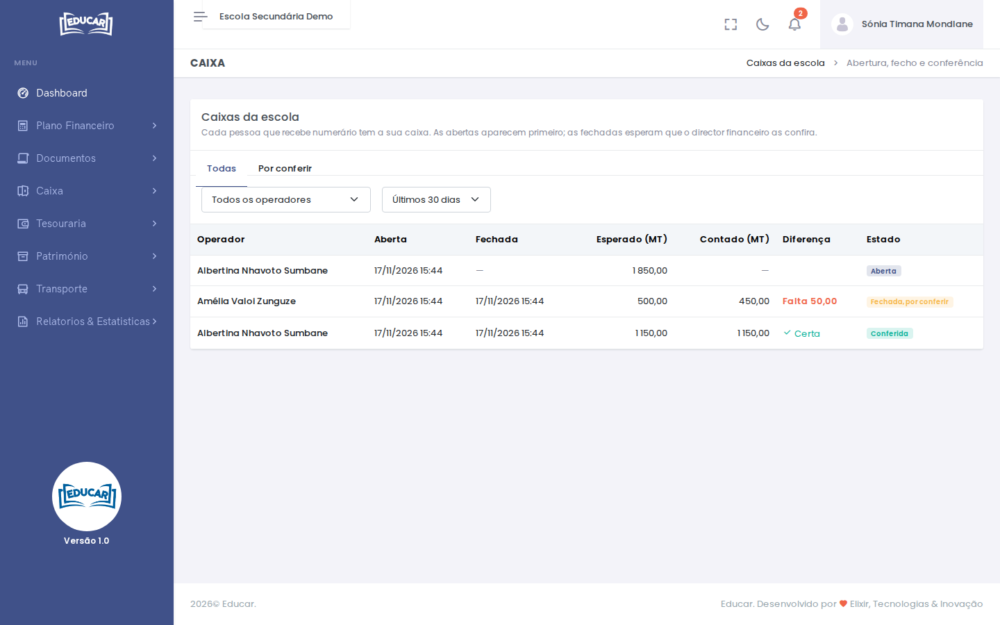
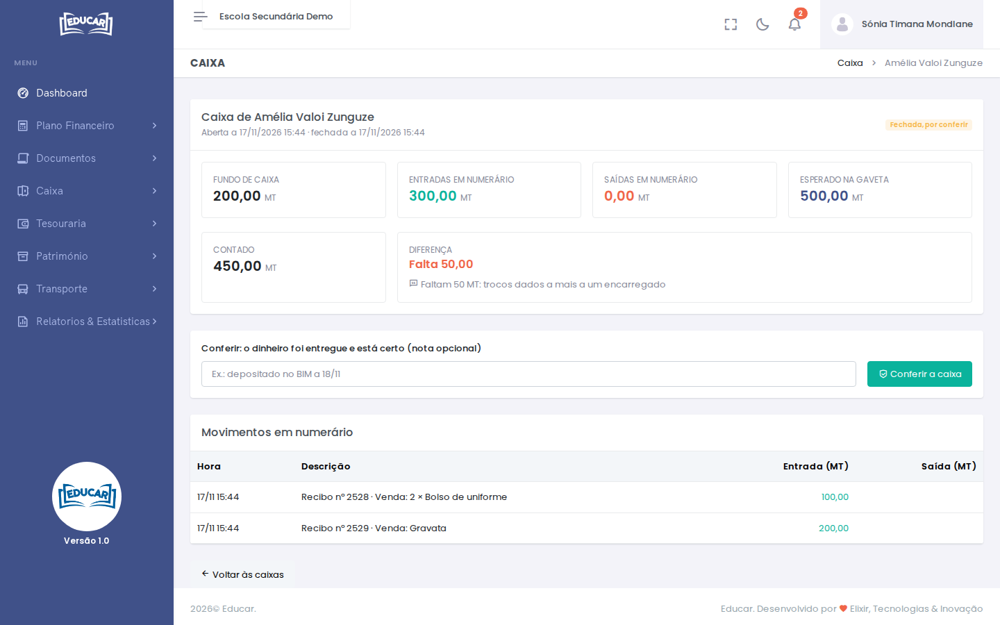

# Caixas da escola

**Menu:** Caixa › Caixas da escola
**Quem vê:** Director financeiro, Funcionário das finanças

As caixas de todas as pessoas que recebem numerário: as abertas primeiro, depois as fechadas por conferir e as conferidas.

Para cada caixa: o operador, quando abriu e fechou, o esperado, o contado, a diferença e o estado. **Por conferir** mostra só as fechadas que esperam o director financeiro. Escolha um operador ou o período (7, 30 ou 90 dias) para filtrar.

## Conferir uma caixa (director financeiro)

1. Abra a caixa fechada. A ficha mostra o fundo, as entradas e saídas em numerário com cada movimento, o esperado, o contado e a explicação da diferença.
2. Confirme que recebeu o dinheiro e, se quiser, escreva uma nota (por exemplo, `Depositado no BIM a 18/11`).
3. Use **Conferir a caixa**.

A caixa fica **Conferida**, com quem a conferiu e quando.
