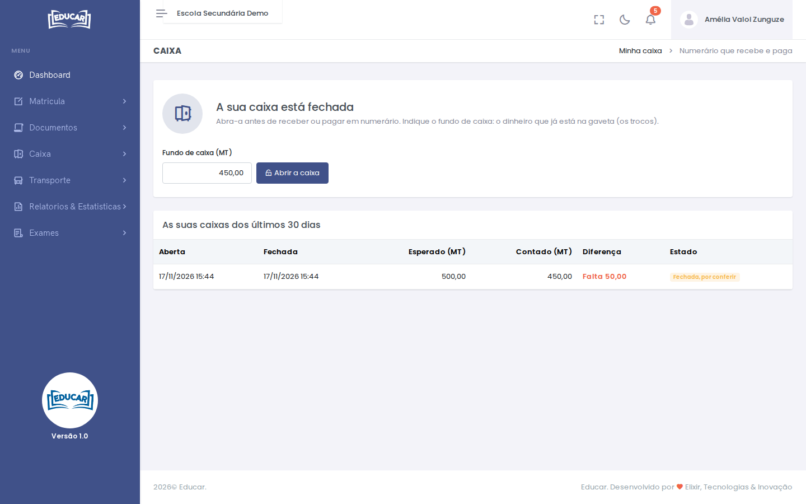
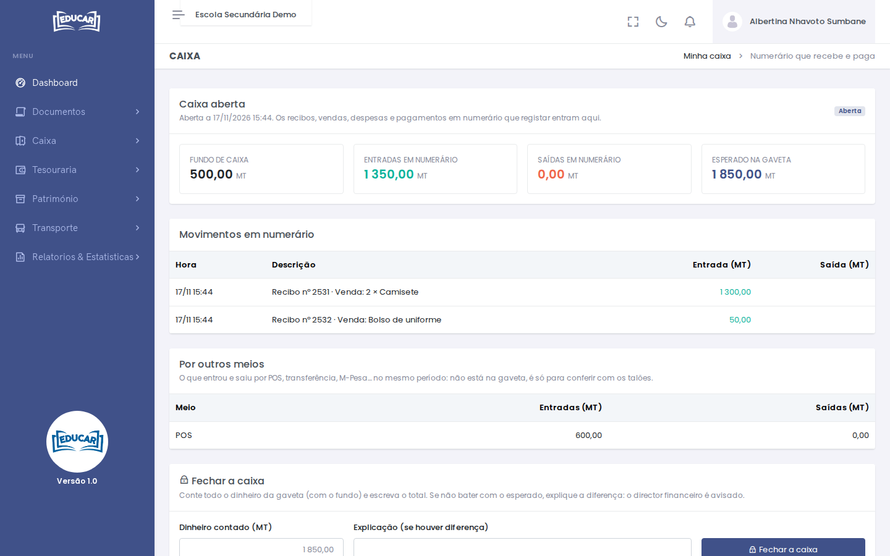

# Minha caixa

**Menu:** Caixa › Minha caixa
**Quem vê:** quem recebe ou paga em numerário (finanças, secretaria e direcção)

A sua caixa: o dinheiro que tem na gaveta, o que entrou e saiu em numerário, e o fecho no fim do dia.

## Abrir a caixa

1. Abra **Caixa › Minha caixa**.
2. Em **Fundo de caixa (MT)**, escreva o dinheiro que já está na gaveta (os trocos). Vem o que contou no último fecho.
3. Use **Abrir a caixa**.

Cada pessoa só tem uma caixa aberta de cada vez.

## O que entra na caixa

Tudo o que registar em **Numerário** enquanto a caixa está aberta:

- **entradas:** recibos das contas dos alunos, [vendas ao balcão](../tesouraria/venda-ao-balcao.md), receitas, inscrições de candidatos externos em exames;
- **saídas:** despesas em [Receitas e Despesas](../tesouraria/receitas-e-despesas.md), pagamentos de [facturas de fornecedores](../tesouraria/contas-a-pagar.md) e de despesas do património;
- **anulações:** anular um recibo ou uma venda em numerário tira o dinheiro da caixa aberta de quem anula.

Em cima ficam o **Fundo de caixa**, as **Entradas** e as **Saídas em numerário** e o **Esperado na gaveta** (fundo + entradas − saídas). Em **Por outros meios** fica o que recebeu ou pagou por POS, transferência, M-Pesa ou e-Mola no mesmo período: não está na gaveta, serve só para conferir com os talões.

Quando a escola exige a caixa aberta, um recibo, uma venda ou uma despesa em numerário sem a caixa aberta é recusado, com o aviso para a abrir. Os outros meios de pagamento não precisam da caixa.

## Fechar a caixa

1. Conte todo o dinheiro da gaveta, com o fundo.
2. Em **Dinheiro contado (MT)**, escreva o total.
3. Se o contado não bater com o esperado, escreva a **Explicação** (por exemplo, trocos dados a mais). Sem explicação, uma caixa com diferença não fecha.
4. Use **Fechar a caixa** e confirme.

Uma caixa fechada já não muda. A ficha mostra o esperado, o contado e a diferença (**Certa**, **Sobra** ou **Falta**). Uma diferença avisa o director financeiro no sino. Entregue o dinheiro como a escola manda; o director financeiro confere a caixa em [Caixas da escola](caixas-da-escola.md).

## Uma caixa de ontem por fechar

Uma caixa aberta num dia anterior tem de ser fechada antes de mais numerário: o ecrã mostra o aviso em vermelho e os registos em numerário são recusados até a fechar. As finanças recebem um aviso no sino com cada caixa que ficou aberta de um dia para o outro.

Por baixo ficam as suas caixas dos últimos 30 dias; clique numa para ver a ficha.
