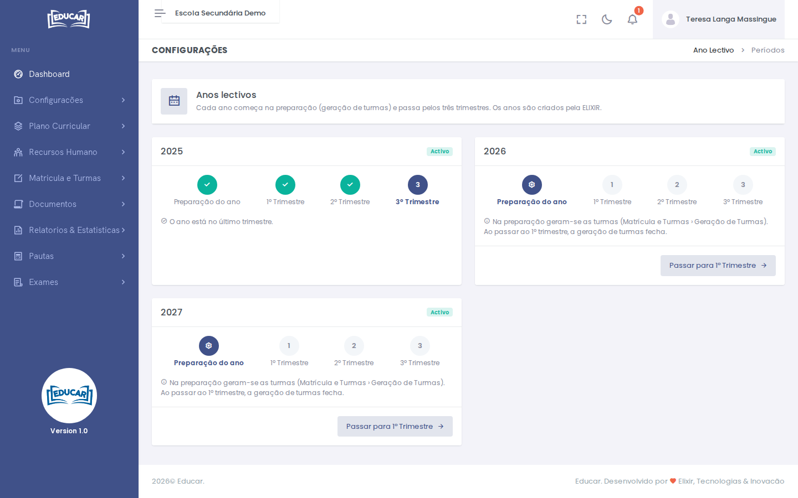

# Ano Académico

**Menu:** Configurações › Ano Académico
**Quem vê:** Director da escola, Director pedagógico

Cada ano lectivo começa na **Preparação do ano**, quando se geram as turmas, e passa depois pelos três trimestres. Este ecrã mostra, para cada ano, em que fase está.

Os anos lectivos são criados pela ELIXIR.

## Passar à fase seguinte

Use o botão no fundo do ano, por exemplo **Passar para 1º Trimestre**.

!!! warning "Geração de turmas"
    Na preparação geram-se as turmas ([Matrícula e Turmas › Geração de Turmas](../matricula-e-turmas/geracao-de-turmas.md)). Ao passar ao 1º trimestre, a geração de turmas fecha.

As fases já feitas aparecem com um visto e a actual fica destacada.
