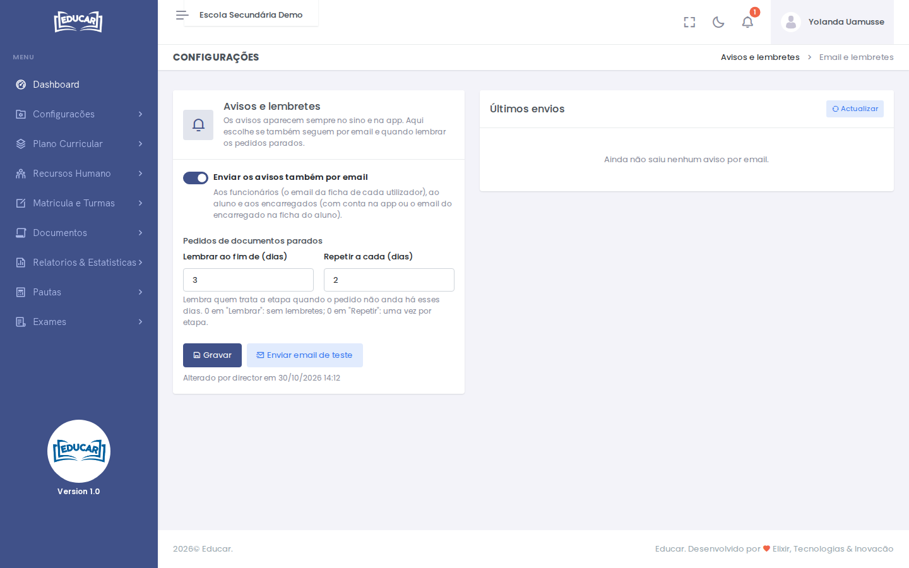

# Avisos e Lembretes

**Menu:** Configurações › Avisos e Lembretes
**Quem vê:** Director da escola, Director pedagógico

Os avisos aparecem sempre no sino, no topo do ecrã, e na app (veja [Avisos](../../primeiros-passos/avisos.md)). Aqui a escola escolhe se também seguem por email, e quando lembrar quem tem pedidos de documentos parados.

## Avisos por email

Ligue **Enviar os avisos também por email**. Cada aviso segue para:

- os funcionários, para o email da ficha de cada utilizador;
- o aluno e os encarregados, para o email da conta na app ou, se não houver, para o email do encarregado na ficha do aluno.

Use **Enviar email de teste** para confirmar que os emails chegam. Em **Últimos envios** vê, para cada email, quando saiu, para quem, o assunto e o estado. **Actualizar** volta a ler a lista.

!!! note "Servidor de email"
    Os emails saem do servidor de email configurado pela ELIXIR. Enquanto não estiver configurado, o ecrã avisa e os avisos ficam só no sino e na app.

## Lembretes de pedidos parados

Em **Pedidos de documentos parados**:

- **Lembrar ao fim de (dias)**: quando um pedido está na mesma etapa há estes dias, quem trata a etapa recebe um lembrete. Com 0 não há lembretes.
- **Repetir a cada (dias)**: repete o lembrete a cada estes dias, enquanto o pedido não andar. Com 0 lembra uma só vez por etapa.

Use **Gravar**. Por baixo fica quem alterou a configuração e quando.
