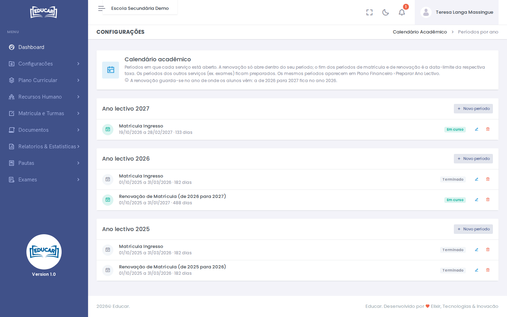

# Calendário Académico

**Menu:** Configurações › Calendário Académico
**Quem vê:** Director da escola, Director pedagógico

Os períodos em que cada serviço está aberto, por ano lectivo: a matrícula de ingresso, a renovação de matrícula e outros (por exemplo, exames).

- A renovação só abre dentro do seu período.
- O fim do período de matrícula e o de renovação é a data-limite da respectiva taxa.
- A renovação guarda-se no ano de onde os alunos vêm: a renovação de 2026 para 2027 fica no ano 2026.

Os mesmos períodos aparecem em [Plano Financeiro › Preparar Ano Lectivo](../plano-financeiro/preparar-ano-lectivo.md).

## Acrescentar um período

1. No ano lectivo, use **Novo período**.
2. Escolha o **Serviço** e indique o início e o fim.
3. Use **Gravar**.

Cada período mostra se está **Próximo**, **Em curso** ou **Terminado**. Use o lápis para o alterar e o caixote do lixo para o apagar.
