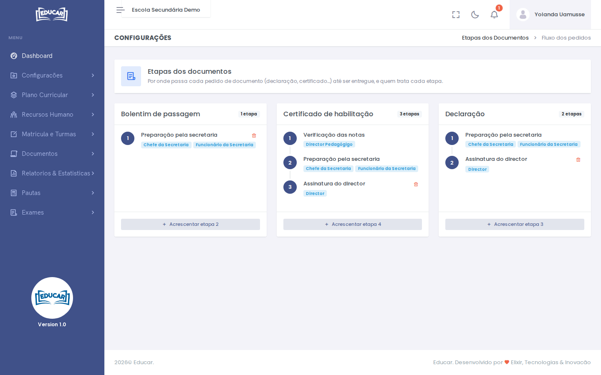

# Etapas dos Documentos

**Menu:** Configurações › Etapas dos Documentos
**Quem vê:** Director da escola, Director pedagógico

Cada documento passa por etapas até ficar pronto, por exemplo a preparação pela secretaria e depois a assinatura do director. Aqui define-se, para cada documento, por que etapas passa e que perfis tratam cada uma.

Os documentos que aparecem são os serviços do tipo **Documento** da escola, em [Plano Financeiro › Serviços e Preços](../plano-financeiro/servicos-e-precos.md).

## Acrescentar uma etapa

1. No documento, use **Acrescentar etapa**.
2. Escreva a descrição da etapa, por exemplo "Assinatura do director".
3. Em **Quem trata**, marque os perfis que tratam a etapa.
4. Use **Gravar etapa**.

A etapa fica no fim das que o documento já tem. Pode haver mais do que um perfil na mesma etapa: qualquer um deles dá conformidade.

## Apagar uma etapa

Só se apaga a última etapa de cada documento, com o ícone do caixote do lixo. Para mudar uma etapa do meio, apague as que estão depois dela e volte a acrescentá-las.

!!! warning "Documentos sem etapas"
    Um documento sem etapas não aceita pedidos, nem na secretaria nem na app.

## Exemplo

| Documento | Etapa 1 | Etapa 2 | Etapa 3 |
|---|---|---|---|
| Declaração | Preparação pela secretaria (secretaria) | Assinatura do director (Director) | |
| Certificado de habilitação | Verificação das notas (Director pedagógico) | Preparação pela secretaria (secretaria) | Assinatura do director (Director) |
