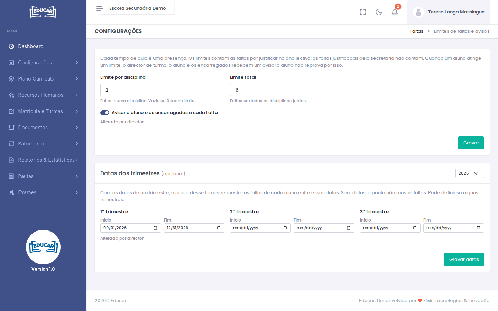

# Faltas

**Menu:** Configurações › Faltas
**Quem vê:** Director da escola, Director pedagógico

Os limites de faltas da escola, os avisos aos encarregados e, se quiser, as datas dos trimestres. Os professores marcam as faltas em [Aulas e presenças](../professor/aulas-e-presencas.md): cada tempo de aula conta como uma presença.

## Limites

- **Limite por disciplina:** quantas faltas um aluno pode ter numa disciplina durante o ano lectivo.
- **Limite total:** quantas faltas pode ter em todas as disciplinas juntas.

Deixe vazio, ou 0, para não ter limite. O limite total não pode ser menor do que o limite por disciplina.

Os limites contam só as faltas **por justificar**, incluindo as ordens de saída. As faltas que a secretaria justifica, na [ficha do aluno](../matricula-e-turmas/pesquisar-turma.md#faltas-do-aluno), não contam.

## O que acontece no limite

Quando um aluno atinge um limite, recebem um aviso:

- o director de turma;
- o aluno e os encarregados, na app e por email, se a escola tiver o email ligado em [Avisos e Lembretes](avisos-e-lembretes.md).

O aluno **não reprova** por isso: o aviso serve para a escola e a família agirem a tempo.

A partir de 80% do limite, o aluno aparece como **Perto do limite** na ficha e na [direcção de turma](../professor/direccao-de-turma.md).

## Aviso a cada falta

Com **Avisar o aluno e os encarregados a cada falta** ligado, a família recebe um aviso sempre que o professor marca uma falta ou uma ordem de saída. Numa aula de dois tempos seguidos, segue um só aviso.

## Datas dos trimestres

As datas são **opcionais**. Servem para a pauta trimestral mostrar as faltas de cada aluno no trimestre.

1. Escolha o ano lectivo, no canto do cartão **Datas dos trimestres**.
2. Indique o início e o fim de cada trimestre que quiser. Pode definir só alguns.
3. Clique em **Gravar datas**.

Cada trimestre tem as duas datas ou nenhuma, e cada trimestre começa depois do fim do anterior. Para tirar as datas de um trimestre, apague-as e grave.

Com as datas de um trimestre, a [pauta trimestral da turma](../pautas/trimestral.md) e a [pauta da disciplina](../professor/as-minhas-turmas.md) desse trimestre ganham uma coluna **Faltas**, com as faltas entre essas datas. As justificadas aparecem à parte. Um trimestre sem datas não mostra faltas na pauta.
