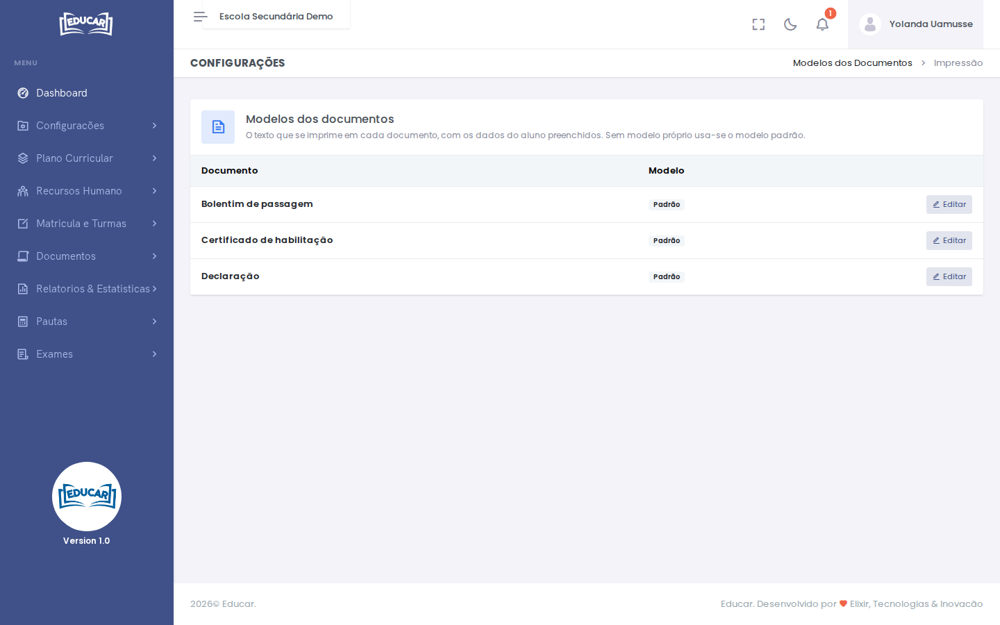
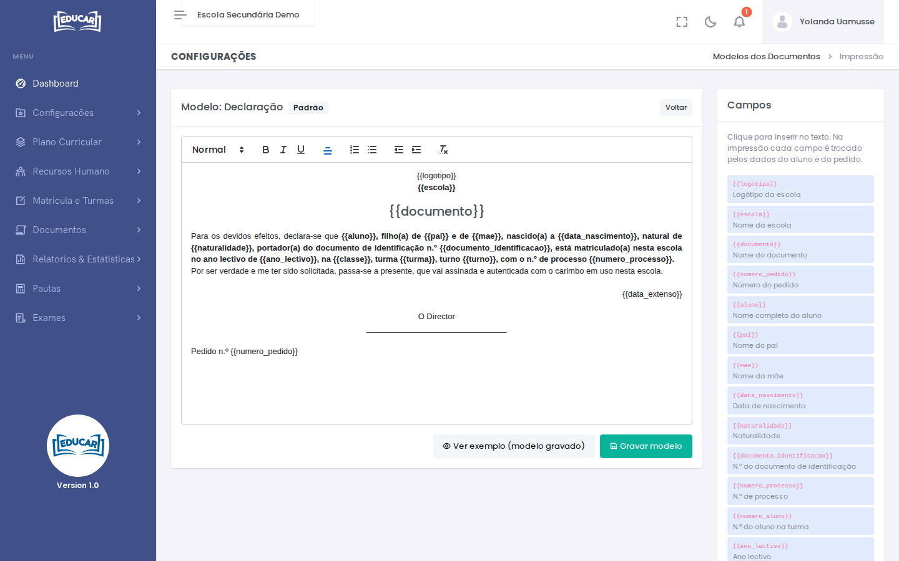

# Modelos dos Documentos

**Menu:** Configurações › Modelos dos Documentos
**Quem vê:** Director da escola, Director pedagógico

O modelo é o texto que se imprime em cada documento. Os dados do aluno e do pedido entram sozinhos. Cada documento começa com o modelo **Padrão**; a escola pode fazer o seu, que aparece como **Próprio**.

## Editar um modelo

1. Use **Editar** no documento.
2. Escreva o texto no editor. A barra de cima dá negrito, itálico, sublinhado, alinhamento e listas.
3. Para pôr um dado do aluno ou do pedido, clique no campo na coluna **Campos**: entra no texto onde estiver o cursor. Na impressão, cada campo é trocado pelo valor do aluno.
4. Use **Gravar modelo**.

**Ver exemplo (modelo gravado)** mostra o modelo gravado preenchido com um exemplo. **Repor modelo padrão** apaga o modelo da escola e volta ao padrão.

## Campos

| Campo | O que fica no documento |
|---|---|
| `{{logotipo}}` | Logótipo da escola |
| `{{escola}}` | Nome da escola |
| `{{documento}}` | Nome do documento |
| `{{numero_pedido}}` | Número do pedido |
| `{{aluno}}` | Nome completo do aluno |
| `{{pai}}`, `{{mae}}` | Nome do pai, nome da mãe |
| `{{data_nascimento}}` | Data de nascimento |
| `{{naturalidade}}` | Naturalidade |
| `{{documento_identificacao}}` | N.º do documento de identificação |
| `{{numero_processo}}` | N.º de processo |
| `{{numero_aluno}}` | N.º do aluno na turma |
| `{{ano_lectivo}}`, `{{classe}}`, `{{turma}}`, `{{turno}}` | Ano lectivo, classe, turma e turno da matrícula |
| `{{encarregado}}` | Encarregado de educação |
| `{{data_emissao}}` | Data de emissão (dd/mm/aaaa) |
| `{{data_extenso}}` | Data de emissão por extenso, por exemplo "30 de Outubro de 2026" |

!!! tip "Dados em falta"
    Um campo sem valor na ficha do aluno fica em branco no documento. Antes de imprimir, confirme na ficha do aluno os dados que o documento usa (por exemplo, a naturalidade).
