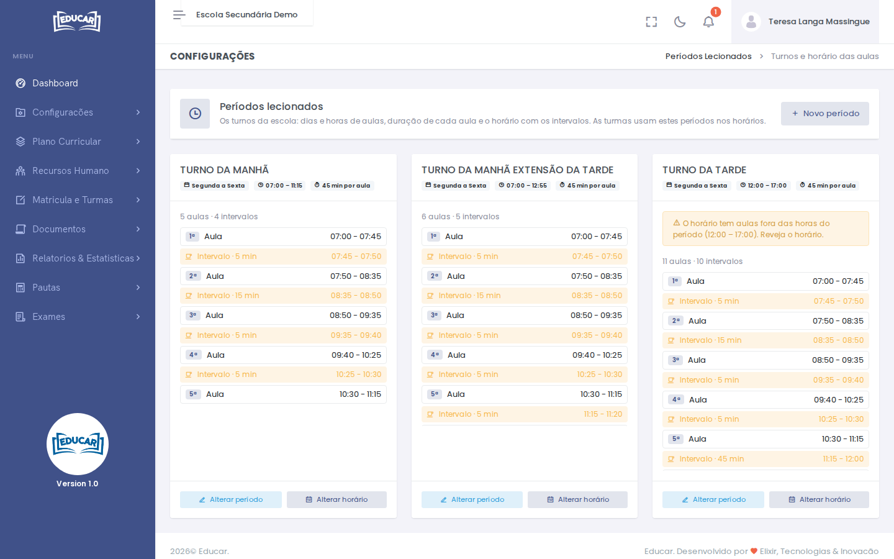

# Períodos Leccionados

**Menu:** Configurações › Períodos Leccionados
**Quem vê:** Director da escola, Director pedagógico

Os turnos da escola (por exemplo, Turno da manhã): os dias e as horas de aulas, a duração de cada aula e o horário com os intervalos. As turmas usam estes períodos nos seus horários.

## Criar um período

1. Use **Novo período**.
2. Preencha o **Nome**, o primeiro e o último dia da semana, a hora de entrada e de saída, e a duração da aula.
3. Use **Gravar período**.

## Definir o horário do período

1. No período, use **Alterar horário**.
2. Cada linha é uma **Aula** ou um **Intervalo**, por ordem, com o início e a duração. Ao acrescentar uma linha, ela começa onde a anterior acaba.
3. **Gerar aulas seguidas** substitui as linhas por aulas seguidas desde a hora de entrada.
4. Use **Gravar horário**.

!!! warning "Turmas que usam o período"
    Alterar o horário muda o horário de todas as turmas que usam este período.

Se o horário tiver aulas fora das horas do período, o cartão avisa, como no Turno da tarde do exemplo.
