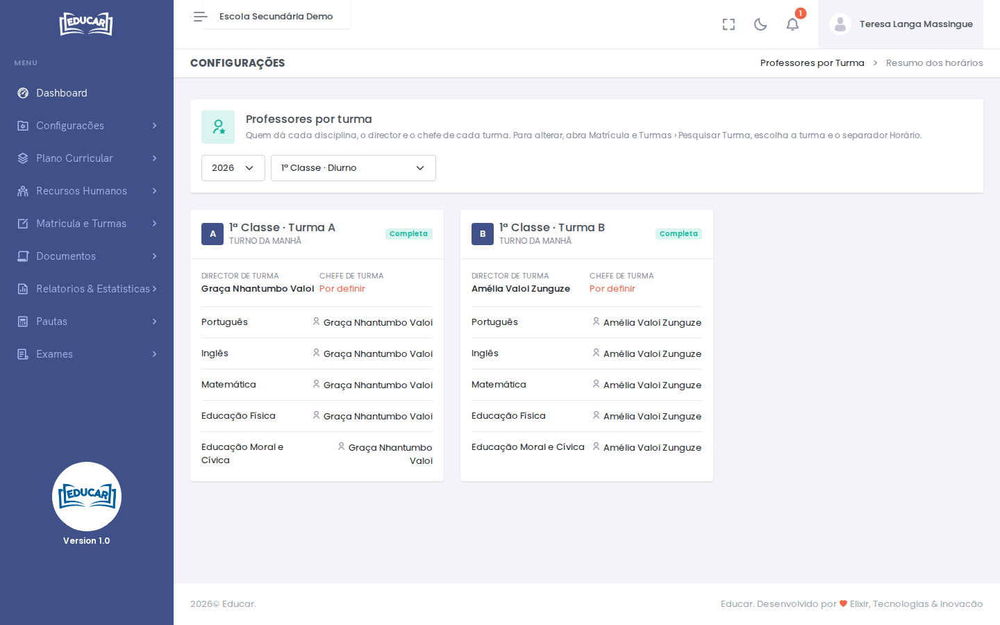

# Professores por Turma

**Menu:** Configurações › Professores por Turma
**Quem vê:** Director da escola, Director pedagógico

Um resumo, turma a turma, de quem dá cada disciplina, de quem é o director de turma e de quem é o chefe de turma. Escolha o ano e a classe.

Cada turma aparece como **Completa**, ou indica o que falta: uma disciplina sem professor, um director ou um chefe de turma **Por definir**, ou uma turma **Sem horário**.

Aqui só se consulta. Para alterar, abra [Matrícula e Turmas › Pesquisar Turma](../matricula-e-turmas/pesquisar-turma.md#horario-da-turma), escolha a turma e o separador **Horário**. Os docentes registam-se em [Recursos Humanos › Docentes](../recursos-humanos/docentes.md).
