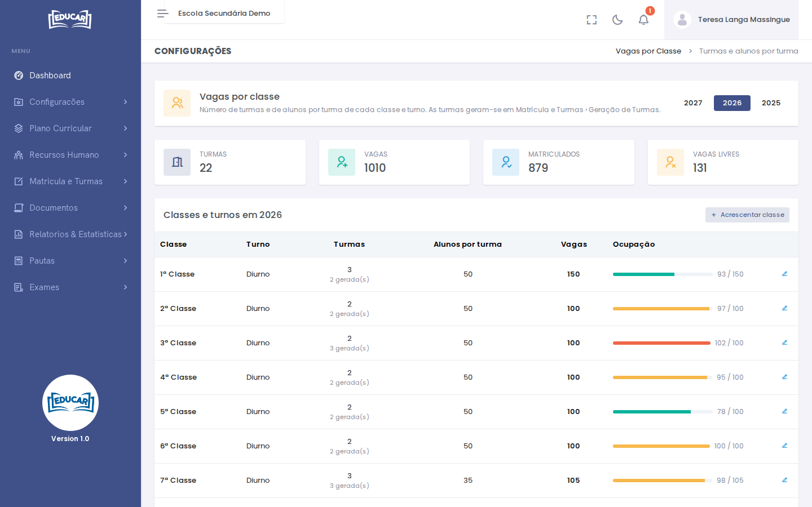

# Vagas por classe

**Menu:** Configurações › Vagas por classe
**Quem vê:** Director da escola, Director pedagógico

Quantas turmas tem cada classe e turno, e quantos alunos cabem em cada turma. As vagas são turmas × alunos por turma.

As classes e turnos daqui são os que aparecem nos preços ([Preços por Classe](../plano-financeiro/precos-por-classe.md)), nos novos ingressos e na geração de turmas.

No topo escolhe o ano lectivo. Os números resumem o ano: turmas, vagas, alunos matriculados e vagas livres. A barra de **Ocupação** de cada linha fica vermelha quando os matriculados passam das vagas.

## Acrescentar ou alterar uma classe

1. Use **Acrescentar classe** (ou o lápis na linha da classe).
2. Escolha a **Classe e turno**.
3. Indique o número de **Turmas** e de **Alunos por turma**. As vagas calculam-se sozinhas.
4. Use **Gravar**.

Na coluna **Turmas**, por baixo do número planeado, aparece quantas turmas já foram geradas. As turmas geram-se em [Matrícula e Turmas › Geração de Turmas](../matricula-e-turmas/geracao-de-turmas.md).
