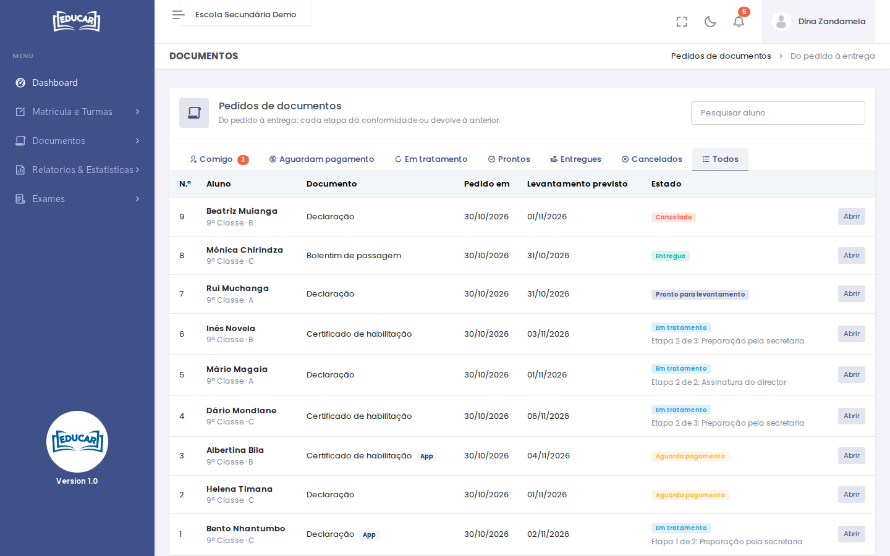
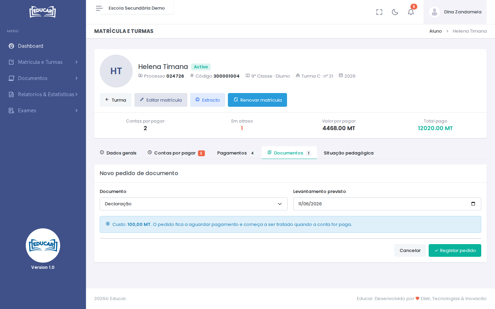
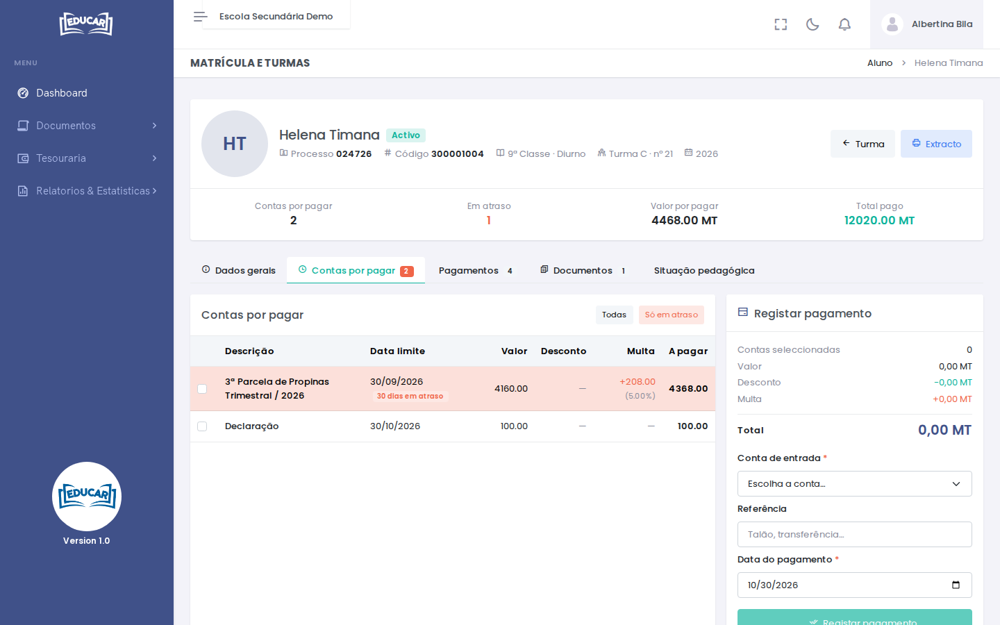
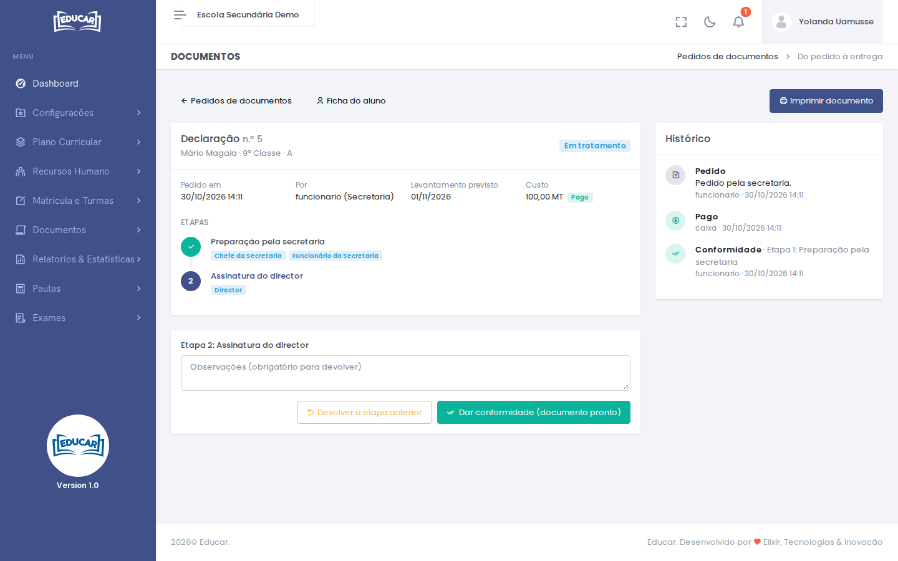
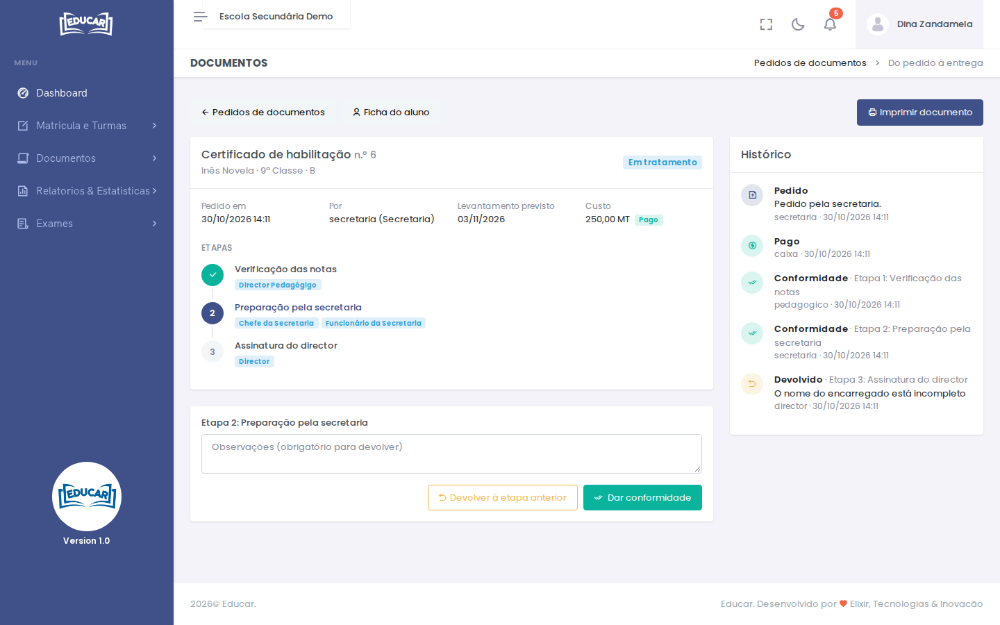
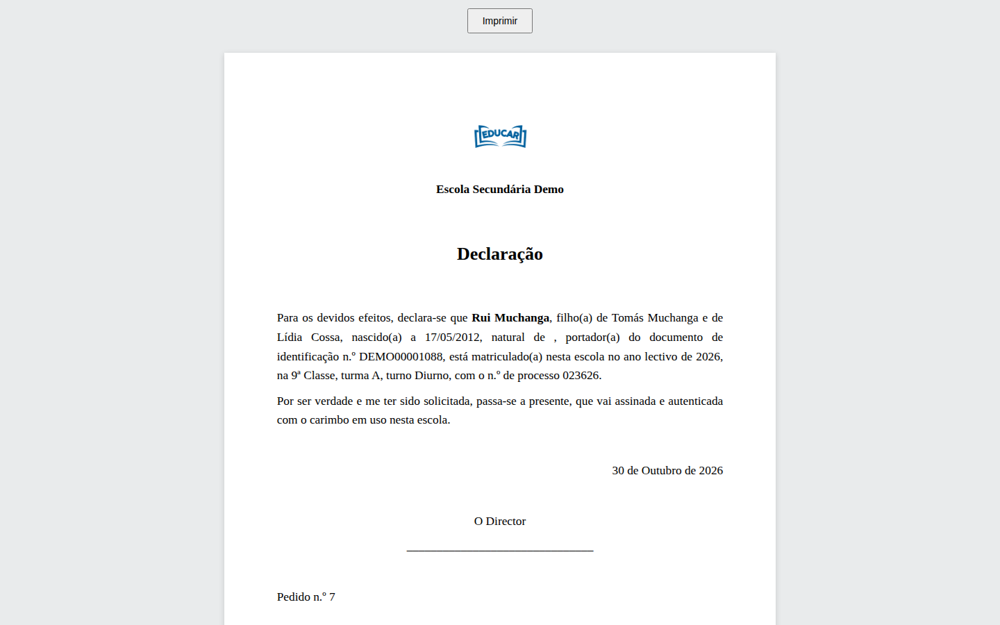
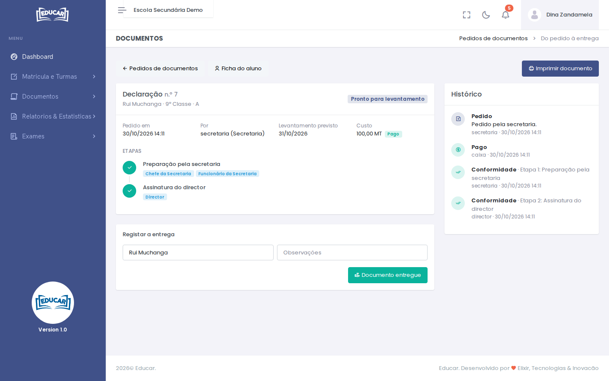

# Pedidos de documentos

**Menu:** Documentos › Pedidos de documentos
**Quem vê:** Chefe da secretaria, Director da escola, Director financeiro, Director pedagógico, Funcionário da secretaria, Funcionário das finanças

Aqui acompanham-se todos os pedidos de documentos da escola, do pedido à entrega. Para ver o processo completo, por ordem e com quem faz cada passo, leia [Pedido de documento](../../processos/pedido-de-documento.md).

## A lista de pedidos

Os separadores filtram a lista:

| Separador | Mostra |
|---|---|
| **Comigo** | Os pedidos que esperam por uma etapa tratada pelo seu perfil. O número ao lado diz quantos são. |
| **Aguardam pagamento** | Pedidos ainda por pagar |
| **Em tratamento** | Pedidos pagos, a passar pelas etapas |
| **Prontos** | Documentos prontos para levantar |
| **Entregues** | Documentos já levantados |
| **Cancelados** | Pedidos cancelados antes de pagos |
| **Todos** | Todos os pedidos |

Use **Pesquisar aluno** para encontrar os pedidos de um aluno. Os pedidos feitos na app têm a etiqueta **App**. Na coluna **Estado**, os pedidos em tratamento indicam também a etapa em que estão.

Use **Abrir** para ver um pedido.

## Registar um pedido

O pedido regista-se na ficha do aluno, no separador **Documentos**.

1. Use **Novo pedido**.
2. Escolha o **Documento**. Por baixo aparece o custo.
3. Indique o **Levantamento previsto**: a data em que o documento deve estar pronto.
4. Use **Registar pedido**.

O pedido fica **Aguarda pagamento**, e a conta do documento fica nas **Contas por pagar** do aluno. Quando a conta é paga, o pedido passa a **Em tratamento**, na 1ª etapa, e quem a trata é avisado. Um documento sem custo segue logo para a 1ª etapa.

O aluno e o encarregado também podem pedir documentos pela app. O pedido aparece na lista com a etiqueta **App**, e a secretaria é avisada de que há uma conta por cobrar.

## O pedido

O pedido mostra:

- o documento, o aluno e o estado;
- quando e por quem foi pedido, a data prevista de levantamento e o custo;
- as **Etapas**, com quem trata cada uma: as já feitas com um visto e a actual destacada;
- o **Histórico**: cada passo, com quem o deu, quando e as observações.

**Ficha do aluno** abre a ficha, no separador **Documentos**.

## Tratar uma etapa

Por baixo do pedido aparece o bloco da etapa actual, mas só para quem a trata.

- **Dar conformidade** passa o pedido à etapa seguinte. Na última etapa, o botão diz **Dar conformidade (documento pronto)** e o pedido fica **Pronto para levantamento**.
- **Devolver à etapa anterior** volta a pôr o pedido na etapa anterior, por exemplo quando falta corrigir alguma coisa. Escreva o motivo nas **Observações**: sem motivo não se devolve.

Quem trata a etapa seguinte (ou a anterior, na devolução) é avisado.

Um pedido devolvido mostra a devolução e o motivo no histórico:

## Imprimir o documento

**Imprimir documento** abre o documento com os dados do aluno já preenchidos, pronto a imprimir. O texto vem do modelo do documento ([Configurações › Modelos dos Documentos](../configuracoes/modelos-dos-documentos.md)).

O botão aparece a partir do momento em que o pedido está pago, para se poder imprimir na etapa em que o documento se prepara.

## Registar a entrega

Num documento pronto aparece o bloco **Registar a entrega**.

1. Indique quem levantou o documento. Vem preenchido com o nome do aluno.
2. Acrescente observações, se precisar.
3. Use **Documento entregue**.

O pedido passa a **Entregue**.

## Cancelar um pedido

Um pedido que ainda aguarda pagamento cancela-se com **Cancelar pedido**, com o motivo. A conta do documento é anulada e o aluno é avisado.

Um pedido já pago não se cancela.

## Os estados do pedido

| Estado | Significado |
|---|---|
| Aguarda pagamento | Pedido registado; a conta está por pagar |
| Em tratamento | Pago; está numa das etapas |
| Pronto para levantamento | Todas as etapas com conformidade |
| Entregue | Documento levantado |
| Cancelado | Cancelado antes de pago |
