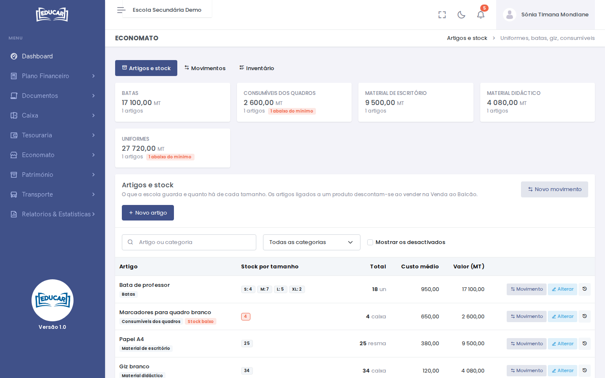
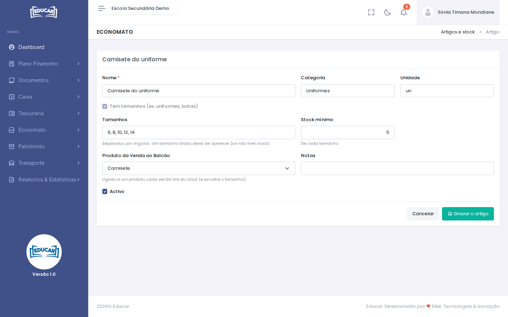

# Artigos e stock

**Menu:** Economato › Artigos e stock
**Quem vê:** Director financeiro, Funcionário das finanças, Gestor do património

Em cima, o valor em stock de cada categoria (quantidade × custo médio) e quantos tamanhos estão abaixo do mínimo. Na lista, cada artigo mostra o stock de cada tamanho (a vermelho os que estão abaixo do mínimo), o total, o custo médio e o valor. Procure pelo nome ou pela categoria.

## Registar um artigo

1. Use **Novo artigo**.
2. Escreva o **Nome**, a **Categoria** (por exemplo `Uniformes`, `Batas`, `Material didáctico`) e a **Unidade** (`un`, `caixa`, `resma`…).
3. Se o artigo tem tamanhos, marque **Tem tamanhos** e escreva-os separados por vírgulas (por exemplo `6, 8, 10, 12` ou `S, M, L`). Depois de criado, um artigo não muda de com tamanhos para sem tamanhos.
4. Em **Stock mínimo**, a quantidade abaixo da qual se deve encomendar (de cada tamanho).
5. Se o artigo se vende, escolha o **Produto da Venda ao Balcão** (por exemplo `Camisete`). Cada produto só se liga a um artigo.
6. Use **Gravar o artigo**. A seguir, registe a primeira entrada em [Movimentos](movimentos.md).

Para mudar, use **Alterar**: pode juntar tamanhos, mudar o mínimo ou desactivar o artigo. Um tamanho tirado deixa de aparecer, se não tiver stock.

## Vender

Um artigo ligado a um produto sai do stock na [Venda ao Balcão](../tesouraria/venda-ao-balcao.md): ao escolher o produto aparece o **Tamanho**, com a quantidade em stock de cada um. Sem stock suficiente, a venda é recusada. Anular a venda devolve ao stock.

## Stock baixo

Quando um tamanho desce abaixo do mínimo, as finanças e o gestor do património recebem um aviso no sino. O aviso fecha-se quando o stock volta a passar o mínimo.
