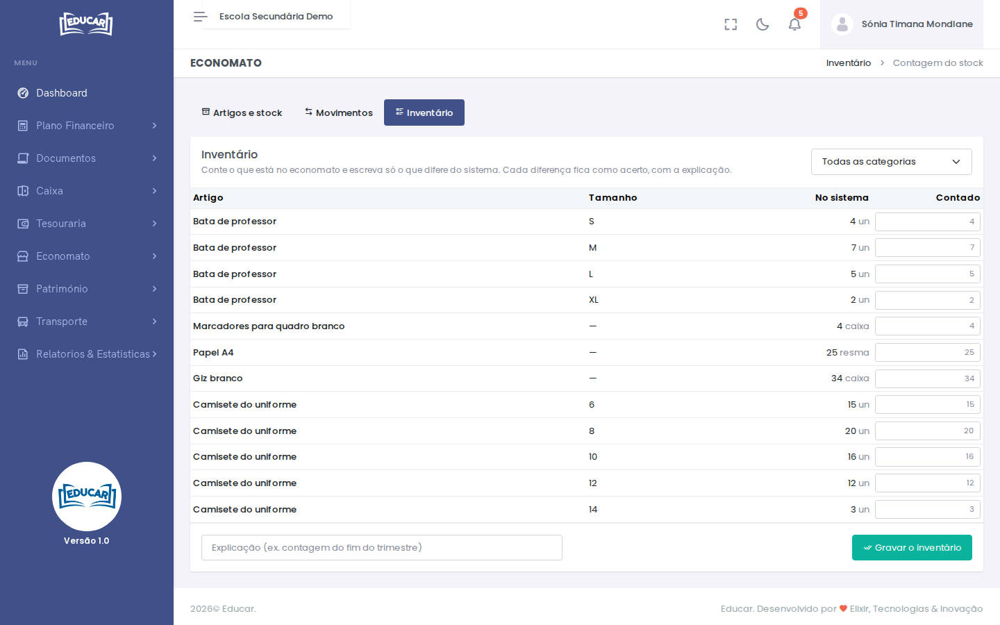

# Inventário

**Menu:** Economato › Inventário
**Quem vê:** Director financeiro, Funcionário das finanças, Gestor do património

Para acertar o stock com a contagem física (por exemplo, no fim do trimestre).

1. Escolha a categoria, ou conte todas.
2. Para cada tamanho, a coluna **No sistema** mostra o que a aplicação tem. Escreva em **Contado** só os que diferem.
3. Escreva a **Explicação** (por exemplo, `Contagem do fim do 3º trimestre`) e use **Gravar o inventário**.

Cada diferença fica como **Acerto de inventário** em [Movimentos](movimentos.md), com quem o fez e a explicação.
