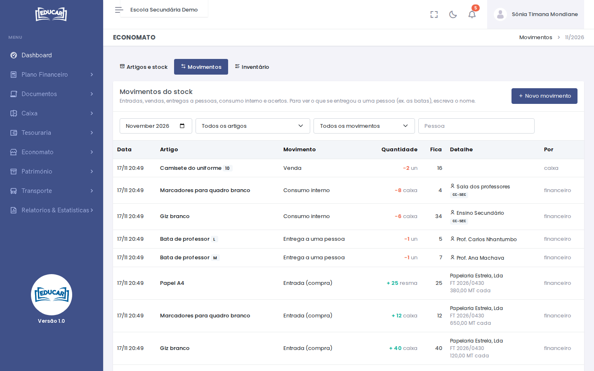
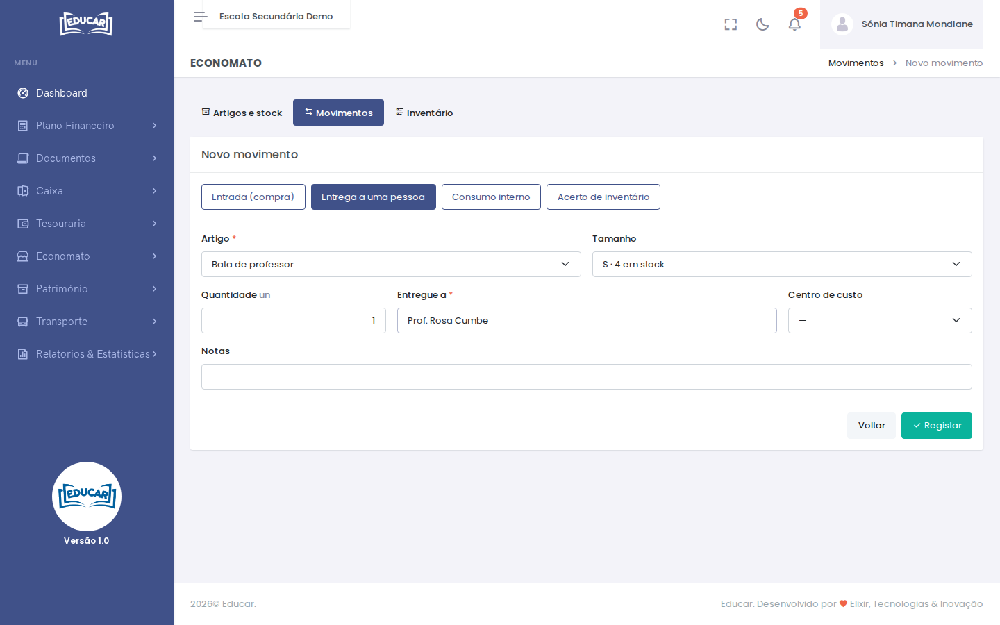

# Movimentos

**Menu:** Economato › Movimentos
**Quem vê:** Director financeiro, Funcionário das finanças, Gestor do património

Tudo o que entra e sai do economato, mês a mês.

## Registar um movimento

1. Use **Novo movimento** (ou **Movimento** na linha do artigo).
2. Escolha o tipo:
    - **Entrada (compra):** o que chegou do fornecedor, com o **Custo unitário**, o **Fornecedor** e o **Nº da factura / guia**. O custo médio do artigo actualiza-se. A factura paga-se em [Contas a pagar](../tesouraria/contas-a-pagar.md).
    - **Entrega a uma pessoa:** por exemplo a bata de um professor. Escreva a quem se entrega.
    - **Consumo interno:** o que se gasta na escola (giz, marcadores, papel), com quem pediu e o **Centro de custo**.
    - **Acerto de inventário:** escreva a **Quantidade contada** e explique o acerto. Para contar vários artigos de uma vez, use o [Inventário](inventario.md).
3. Escolha o **Artigo** e o **Tamanho** (aparece o stock de cada um) e escreva a **Quantidade**.
4. Use **Registar**.

Uma saída nunca deixa o stock negativo: o movimento é recusado com a quantidade que há.

## Procurar

Escolha o mês, o artigo ou o tipo. Para ver tudo o que se entregou a uma pessoa (por exemplo, as batas de um professor), escreva o nome em **Pessoa**. As vendas e as devoluções (vendas anuladas) aparecem aqui sozinhas.
