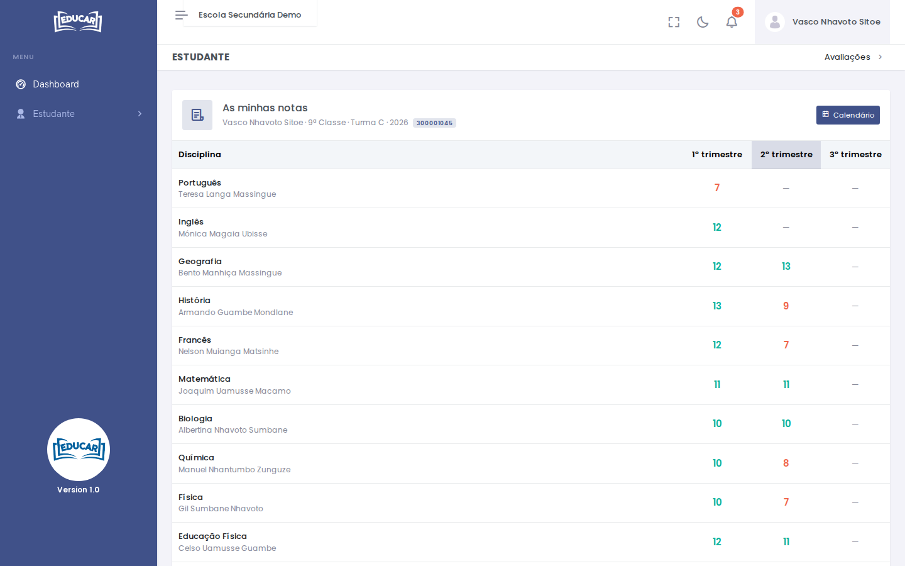
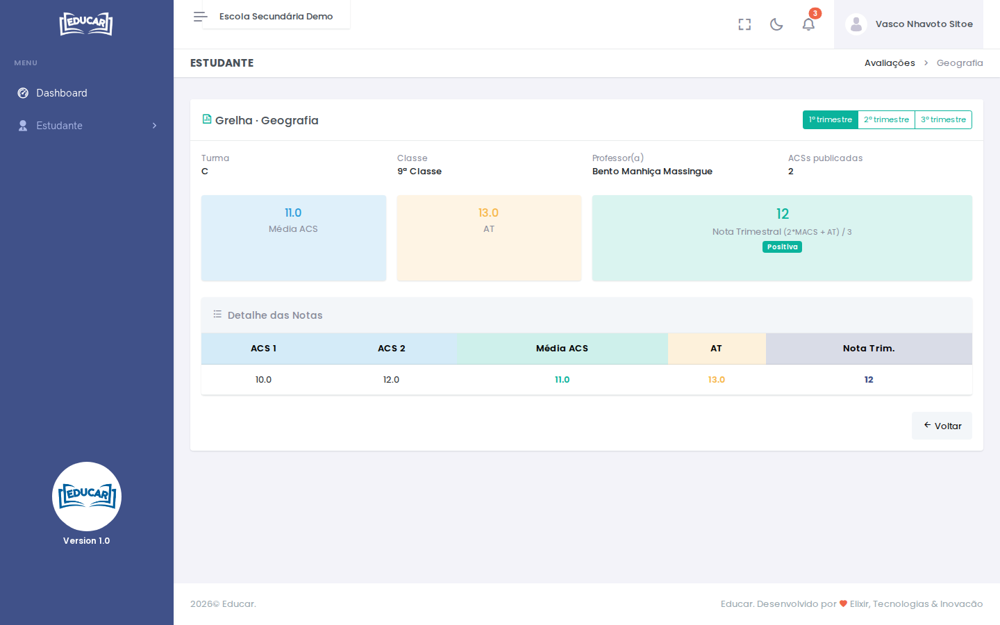
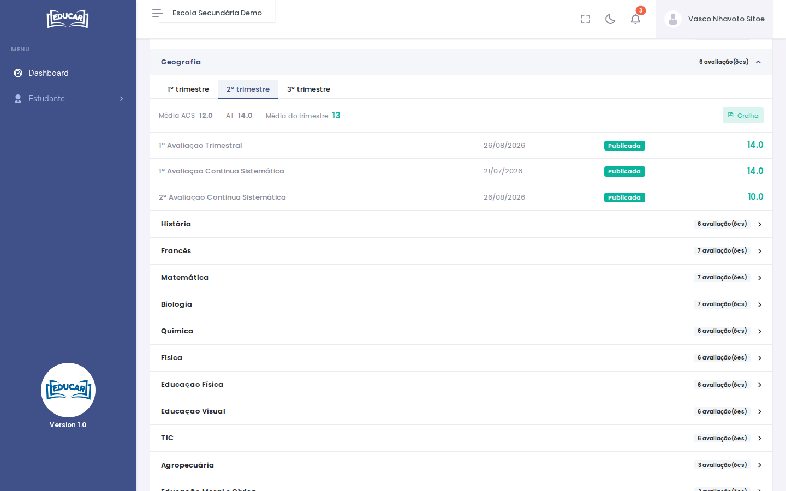

# Avaliações Realizadas

**Menu:** Estudante › Avaliações Realizadas
**Quem vê:** Aluno

As notas do aluno no ano: a média de cada disciplina por trimestre e as avaliações que lhe deram origem.

## As minhas notas

A tabela mostra a média de cada disciplina em cada trimestre, com o trimestre actual assinalado. As médias negativas aparecem a vermelho.

Só contam as notas publicadas pelos professores. A nota aparece quando já há notas de avaliação contínua (ACS) e a avaliação trimestral (AT), e calcula-se pela fórmula indicada por baixo da tabela. As faltas não entram na média.

## Grelha de um trimestre

Toque numa média para abrir a grelha dessa disciplina e trimestre: as notas de cada ACS, a média das ACS, a AT e a nota trimestral.

No topo da grelha pode mudar de trimestre. **Voltar** regressa à lista.

## Avaliações de uma disciplina

Mais abaixo, na página, cada disciplina abre a lista das suas avaliações, por trimestre. **Grelha** abre a grelha do trimestre.

