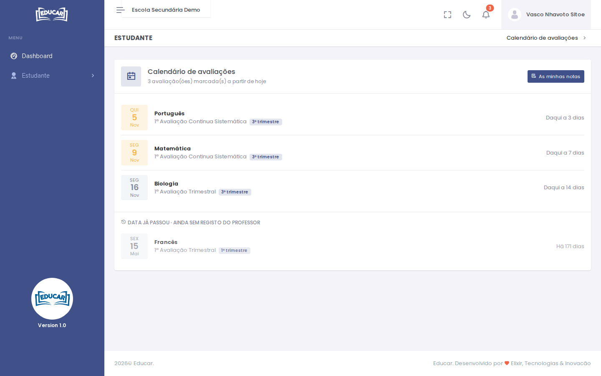

# Calendário de Avaliações

**Menu:** Estudante › Calendário de Avaliações
**Quem vê:** Aluno

As avaliações que os professores marcaram para a turma do aluno.

- **Em cima**, as avaliações marcadas a partir de hoje, da mais próxima para a mais distante, com os dias que faltam.
- **Em baixo**, em **Data já passou · ainda sem registo do professor**, as avaliações cuja data passou e que o professor ainda não registou.

Cada linha indica a disciplina, a avaliação e o trimestre. **As minhas notas** abre [Avaliações Realizadas](avaliacoes-realizadas.md).

Os exames não aparecem aqui. As datas dos exames estão na app. Ver [A app](../../primeiros-passos/app.md).
