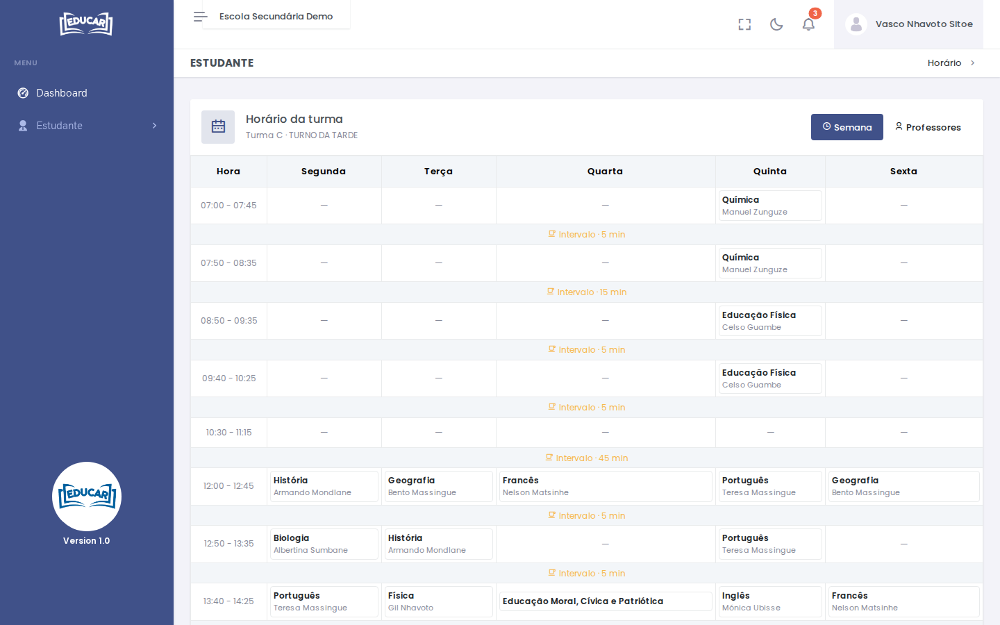
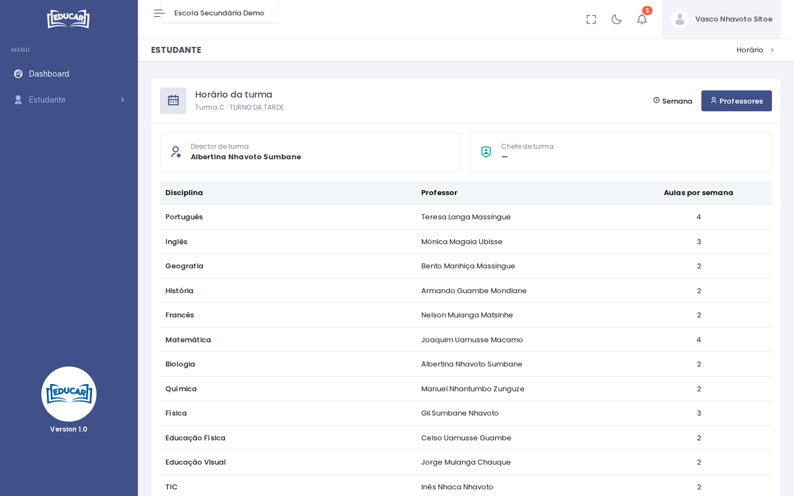

# Horário

**Menu:** Estudante › Horário
**Quem vê:** Aluno

O horário da turma do aluno e os professores de cada disciplina.

## Semana

O separador **Semana** mostra as aulas de cada dia, com o professor, e os intervalos entre elas.

Se a escola ainda não publicou o horário, aparece **Horário ainda não disponível**.

## Professores

O separador **Professores** indica o director de turma, o chefe de turma e, por disciplina, o professor e as aulas por semana.

