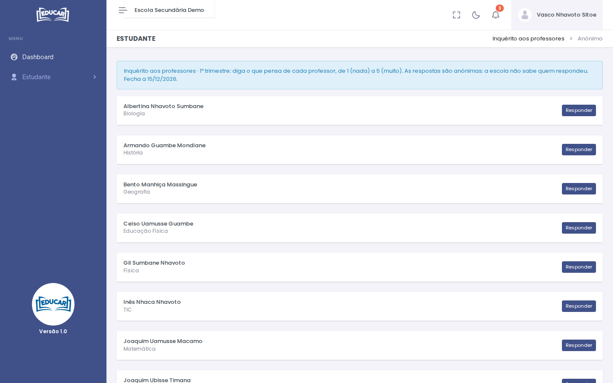

# Inquérito aos professores

**Menu:** Estudante › Inquérito aos professores
**Quem vê:** Aluno

Quando a escola abre um inquérito, o aluno diz o que pensa de cada professor da sua turma.

1. Carregue em **Responder** no professor.
2. Em cada pergunta, escolha de **1** (nada) a **5** (muito).
3. Escreva um comentário, se quiser, e carregue em **Enviar**.

Responde-se uma vez por professor. As respostas são **anónimas**: a escola só sabe que o aluno já respondeu, não o que respondeu. A escola só vê os resultados de um professor quando muitos alunos responderam.

Sem inquérito aberto, o ecrã diz que não há nenhum.
