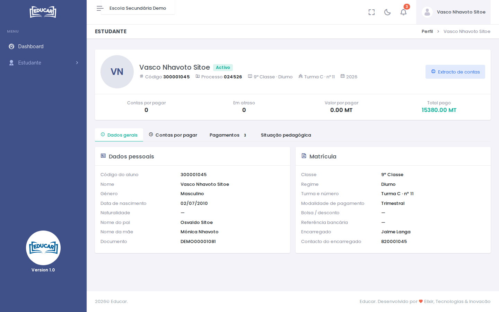
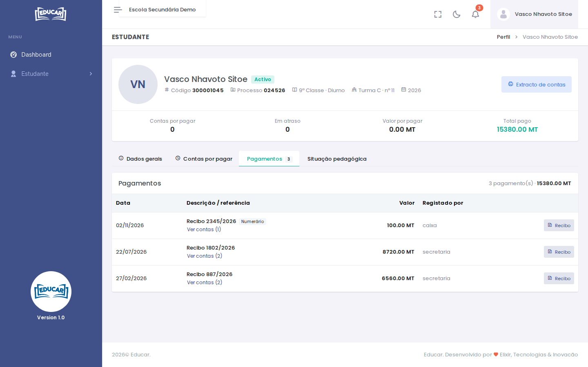

# Perfil

**Menu:** Estudante › Perfil
**Quem vê:** Aluno

A ficha do aluno na sua última matrícula na escola: dados, contas e situação pedagógica. Aqui só se consulta. Para corrigir um dado, fale com a secretaria.

No topo aparecem o código do aluno, o número de processo, a classe, a turma e o ano, e os totais das contas: por pagar, em atraso, valor por pagar e total pago.

## Os separadores

| Separador | O que mostra |
|---|---|
| **Dados gerais** | Os dados pessoais e os da matrícula: regime, turma, modalidade de pagamento, bolsa, referência bancária e encarregado |
| **Contas por pagar** | As contas ainda não pagas e as que estão em atraso |
| **Pagamentos** | Os pagamentos feitos, com o recibo de cada um |
| **Situação pedagógica** | As médias de cada disciplina nos trimestres já encerrados e, com o ano fechado, as notas finais |

**Extracto de contas**, no topo, abre o extracto do aluno, e **Recibo** abre o recibo de um pagamento. As notas das avaliações estão em [Avaliações Realizadas](avaliacoes-realizadas.md).

## Contas fora do prazo

Com uma conta fora do prazo, o aluno vê a página **Acesso Suspenso** em vez dos ecrãs do site. Depois de pagar na secretaria, o acesso volta sozinho.

!!! note "Sem matrícula"
    Se não houver nenhuma matrícula do aluno na escola escolhida, os ecrãs do menu Estudante mostram o aviso **Sem matrícula nesta escola**. Se acabou de se matricular, fale com a secretaria.
