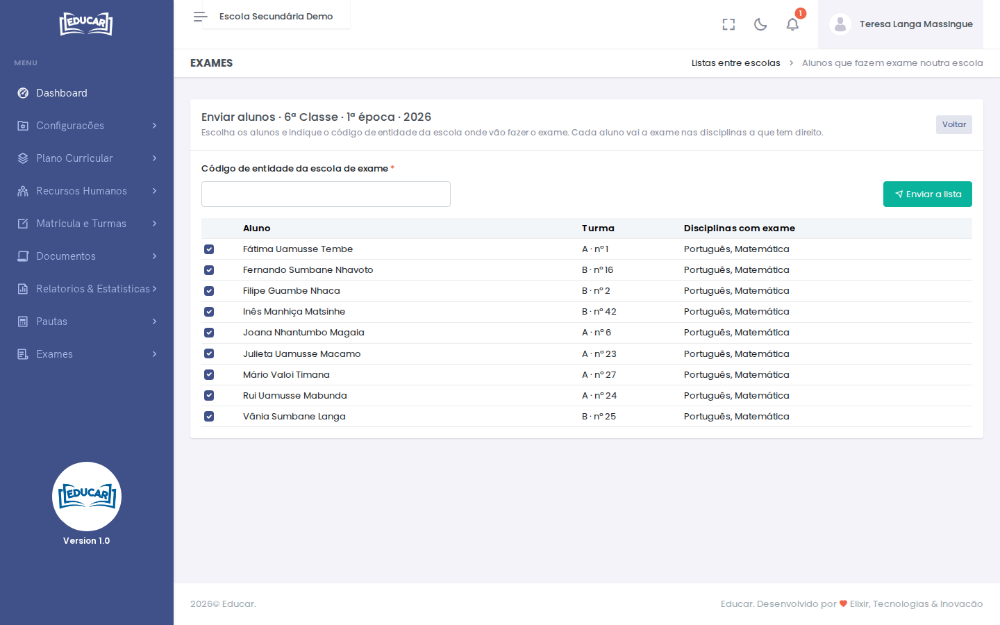
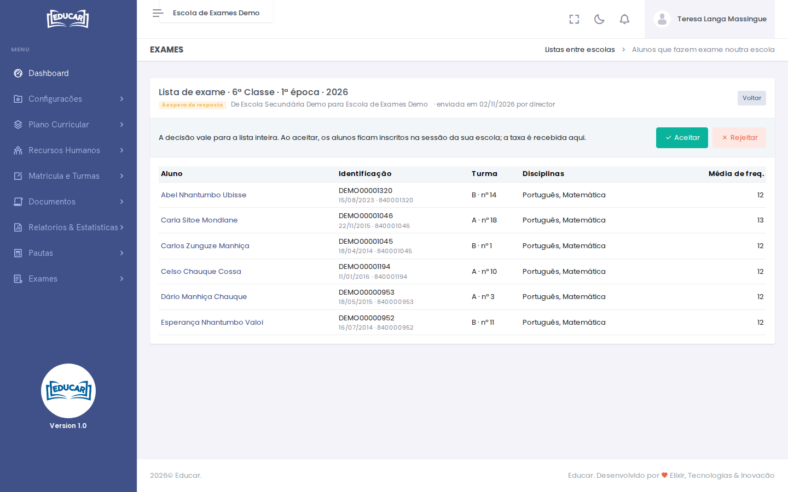
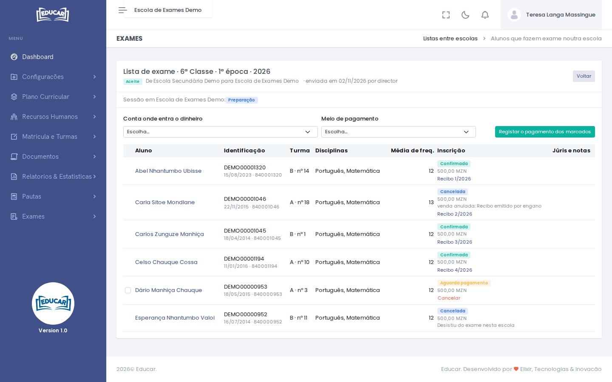
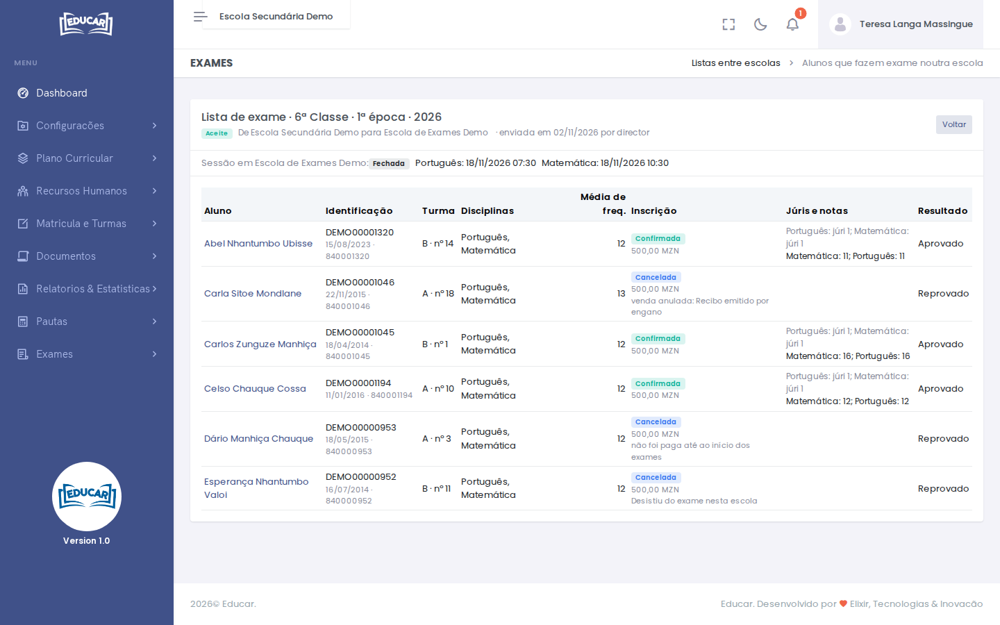

# Listas entre escolas

**Menu:** Exames › Listas entre escolas
**Quem vê:** Director da escola, Director pedagógico, secretaria

Serve para os alunos de uma escola fazerem exame noutra. Há duas escolas no processo:

| Escola | O que faz |
|---|---|
| **Escola de origem** (onde o aluno está matriculado) | Escolhe os alunos, envia a lista, acompanha o processo e fecha o resultado final |
| **Escola de exame** (onde o aluno faz a prova) | Aceita ou rejeita a lista, recebe a taxa, forma os júris e lança as notas |

As notas ficam ligadas à matrícula do aluno na escola de origem. A escola de exame consulta os dados dos alunos da lista e a média de frequência, mas não os pode alterar. A ficha do aluno só se corrige na escola de origem.

## Enviar uma lista (escola de origem)

Peça primeiro à escola de exame o seu **código de entidade**. A sessão tem de ter a [pauta de admissão](sessoes-de-exame.md#pauta-de-admissao-1a-epoca) publicada, na 1ª época, e estar em preparação ou em inscrições.

1. Em **Listas entre escolas**, use o botão da sessão, em **Enviar alunos de**.
2. Escreva o **Código de entidade da escola de exame**.
3. Deixe marcados os alunos a enviar. Cada aluno vai a exame nas disciplinas a que tem direito.
4. Use **Enviar a lista**.

Enquanto não houver resposta, **Anular a lista** retira o pedido. Os alunos da lista já não se inscrevem na escola de origem: em [Inscrições](inscricoes.md) aparecem com a escola de exame.

## Aceitar ou rejeitar (escola de exame)

A lista aparece em **Listas recebidas**. Antes de aceitar, a escola precisa de:

- ter criada a [sessão de exame](sessoes-de-exame.md) do mesmo ano, classe e época, em preparação ou em inscrições;
- ter definidas as [taxas de exame](../plano-financeiro/taxas-de-exame.md) dessa classe e época (0 se não se cobra);
- ter exame de todas as disciplinas da lista.

A direcção abre a lista e decide. A decisão vale para a lista inteira:

- **Aceitar** inscreve todos os alunos na sessão da escola de exame.
- **Rejeitar** pede um motivo, que a escola de origem vê. Depois de corrigir o que for preciso, a escola de origem envia uma lista nova.

Se a escola de exame não tiver alunos próprios nessa classe, a sessão não precisa de pauta de admissão.

## Receber as taxas (escola de exame)

A taxa é da escola de exame. Sem taxa a cobrar, as inscrições ficam logo confirmadas. Com taxa, cada inscrição aguarda o pagamento:

1. Abra a lista e marque os alunos que pagaram.
2. Escolha a **Conta onde entra o dinheiro** e o **Meio de pagamento**.
3. Use **Registar o pagamento dos marcados**. Cada aluno fica com o seu recibo, na coluna **Inscrição**.

**Cancelar** retira um aluno por pagar, com motivo. Para retirar um aluno que já pagou, anule o recibo em [Venda ao balcão](../tesouraria/venda-ao-balcao.md). Ao começarem os exames, as inscrições por pagar são canceladas, como as dos alunos da própria escola. A escola de origem pode enviar um aluno cancelado noutra lista, enquanto a sessão dela estiver em preparação ou em inscrições.

## Júris e notas (escola de exame)

A partir daqui, os alunos da lista seguem o processo normal da sessão: entram nos júris e nas [pautas de exame](pautas-de-exame.md), onde aparecem com o nome da escola de origem no lugar da turma. A escola de exame [publica as notas](sessoes-de-exame.md) como faz com as dos seus alunos.

O resultado final destes alunos não aparece na escola de exame: é calculado na escola de origem.

## Acompanhar e fechar (escola de origem)

A escola de origem abre a lista em **Listas enviadas** e vê, por aluno, o estado da inscrição e os júris. Vê também o calendário das provas na escola de exame e, depois de publicadas, as notas.

Na sessão da escola de origem:

- se todos os alunos fizerem exame noutra escola, não é preciso marcar provas;
- os exames não começam com uma lista à espera de resposta;
- as notas só se publicam depois de todas as escolas de exame publicarem as suas.

O [resultado](sessoes-de-exame.md) fecha-se como de costume: a nota final junta a média de frequência da escola de origem e a nota do exame. Um aluno que não chegou a fazer o exame, por exemplo porque a inscrição foi cancelada, fica sem nota de exame, como qualquer aluno não inscrito.
