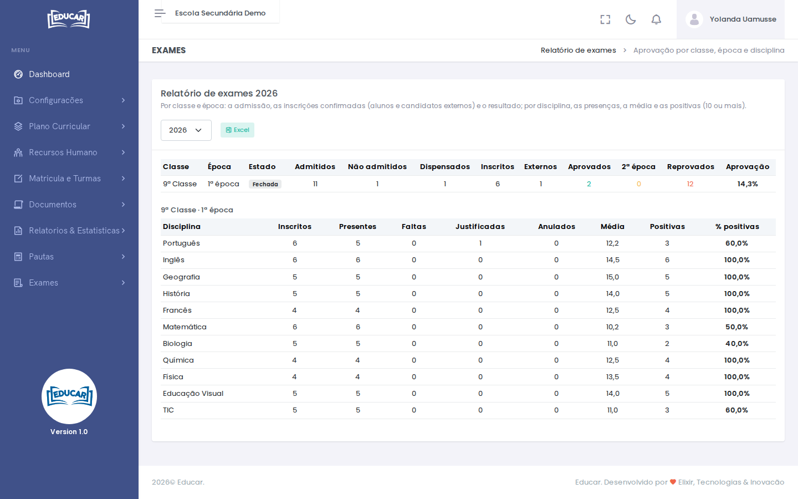

# Relatório de exames

**Menu:** Exames › Relatório de exames
**Quem vê:** Director da escola, Director pedagógico

Escolha o ano lectivo no canto superior direito. O relatório tem duas partes.

**Por classe e época** mostra:

- admitidos, não admitidos e dispensados;
- inscritos confirmados, e quantos desses são candidatos externos;
- aprovados, 2ª época e reprovados;
- a percentagem de aprovação, depois de a sessão estar fechada.

**Por disciplina** mostra inscritos, presentes, faltas, faltas justificadas, anulados, a média e as positivas (10 ou mais), em número e em percentagem.

O botão **Excel** exporta as duas partes, cada uma na sua folha.

