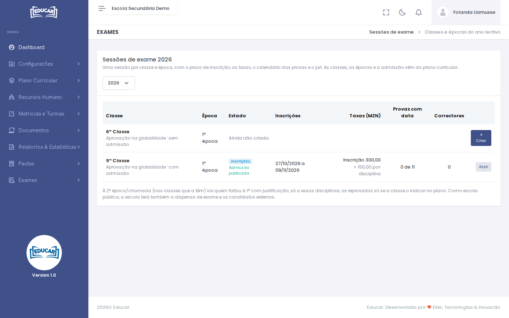
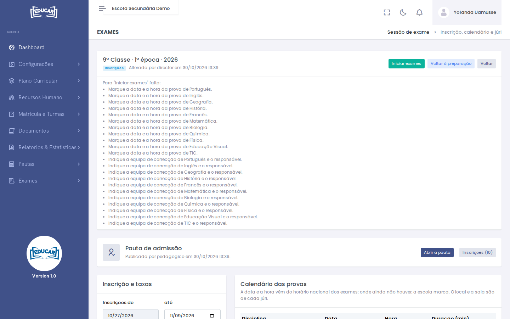
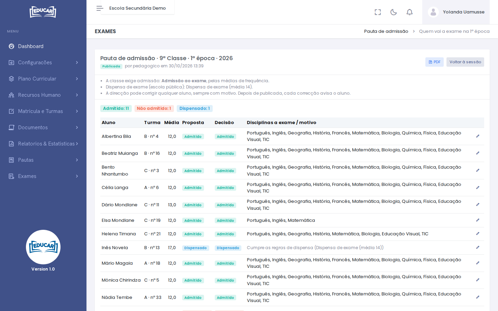
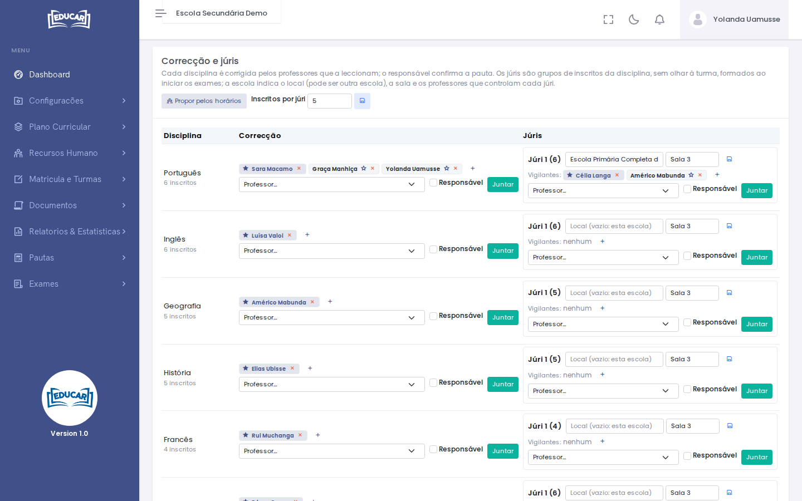
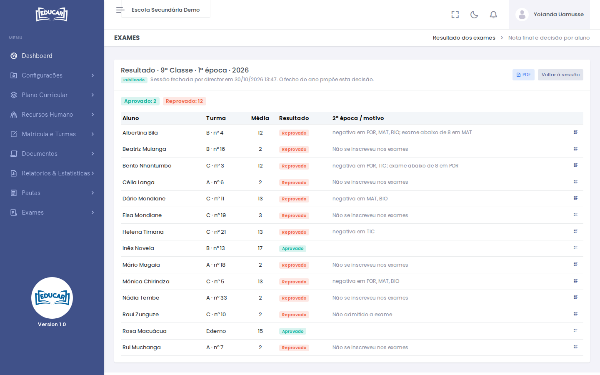

# Sessões de exame

**Menu:** Exames › Sessões de exame
**Quem vê:** Director da escola, Director pedagógico

Uma **sessão de exame** reúne tudo o que diz respeito aos exames de uma classe, numa época e num ano lectivo. São exemplos a 9ª Classe na 1ª época de 2026 e a 12ª Classe na 2ª época.

## A lista de sessões

O ecrã mostra as classes com exame no ano lectivo escolhido (no canto superior direito) e, para cada época, a sessão:

- o **estado** da sessão e se a pauta de admissão já foi publicada;
- o **prazo** de inscrição e as **taxas**;
- quantas **provas** já têm data e quantos **professores** estão na correcção.

As classes com exame e o número de épocas vêm do plano curricular. Se uma classe só tem 1ª época, não aparece linha para a 2ª.

Para criar uma sessão, use **Criar** na linha da classe e época. A 2ª época só se cria depois da 1ª.

## Os estados da sessão

| Estado | O que acontece | Para passar ao seguinte |
|---|---|---|
| **Preparação** | Marca-se o prazo, prepara-se a admissão e a correcção | Prazo marcado, taxas definidas, pauta de admissão publicada (1ª época) ou 1ª época fechada (2ª época) |
| **Inscrições** | A secretaria e a app inscrevem os alunos | Provas com data e hora, e um responsável da correcção em cada disciplina com inscritos |
| **Em curso** | Formam-se os júris; a correcção lança as notas | Pautas de todas as disciplinas confirmadas |
| **Resultados publicados** | Os alunos já vêem as notas; a direcção revê o resultado | Nenhum aluno por decidir |
| **Fechada** | O resultado está gravado e vai para o fecho do ano | — |

O botão da próxima mudança fica no topo da sessão. Se ainda faltar alguma coisa, a sessão diz exactamente o quê.

!!! tip "Iniciar exames"
    Ao passar a **Em curso**, as inscrições por pagar são canceladas, os alunos são avisados e os júris formam-se com os inscritos que ficaram.

## Inscrição e taxas

Indique o período de inscrição e use **Gravar o prazo**. Com as inscrições já abertas, o prazo só se pode **prolongar**.

As taxas mostradas aqui vêm do [Plano Financeiro › Taxas de exame](../plano-financeiro/taxas-de-exame.md). A sessão não as altera.

## Calendário das provas

Cada disciplina com exame tem a sua prova, com data, hora e duração.

- Se a disciplina tiver o selo **Horário nacional**, a data e a hora vêm do horário nacional e não se mudam.
- Nas restantes, a escola marca a data e a hora e grava com o botão da linha.

Com os exames em curso, cada linha mostra também o estado da pauta e abre-a.

## Pauta de admissão (1ª época)

O bloco **Pauta de admissão** abre a pauta onde o sistema propõe, para cada aluno, uma decisão:

- **Admitido**: vai a exame. Na passagem por disciplina, mostra também a que disciplinas vai;
- **Não admitido**: não vai a exame, e a pauta mostra o motivo;
- **Dispensado**: só nas escolas públicas, com a média definida no plano (ex. 14). Não faz exame e a nota final é a média de frequência;
- **Por decidir**: faltam médias de frequência para decidir.

Os passos são estes:

1. **Calcular**: o sistema faz a proposta a partir das médias de frequência. Pode voltar a calcular sempre que as médias mudem.
2. **Corrigir**, se for preciso: o lápis na linha do aluno muda a decisão. O motivo é obrigatório e fica registado.
3. **Publicar**: só é possível sem alunos por decidir. Os alunos e encarregados recebem o aviso. A partir daqui só se corrige aluno a aluno, e cada correcção avisa o aluno.
4. **PDF**: a pauta para afixar.

!!! note "Aluno retido no ano anterior"
    Se o aluno ficou retido na passagem por disciplina ou por secção, as disciplinas que já tem feitas aparecem como "Feitas no ano anterior". Não volta a fazer exame a essas.

## Correcção e júris

### Equipas de correcção

Cada disciplina é corrigida pelos professores que a leccionam.

1. **Propor pelos horários** junta a cada disciplina os professores que a dão nas turmas da classe.
2. Use o **+** para juntar outro professor e o **×** para tirar um.
3. Escolha o **responsável** de cada disciplina com a **estrela**. É ele quem confirma a pauta. Os exames não começam sem um responsável em cada disciplina com inscritos.

### Júris

Os júris são grupos de inscritos de uma disciplina, sem olhar à turma.

- Em **Inscritos por júri** indica-se o tamanho de cada júri (30 por omissão).
- Os júris formam-se ao **iniciar os exames**, por ordem alfabética. Uma sobra pequena junta-se ao último júri.
- Em cada júri, indique o **local** (deixe vazio se for a própria escola) e a **sala**, e grave.
- Junte os **vigilantes** (os professores que controlam o júri) e escolha o responsável com a estrela.

Se o tamanho dos júris mudar com os exames em curso, os júris refazem-se nas disciplinas ainda sem notas. Cada júri mantém o local, a sala e os vigilantes que tinha.

## Publicar as notas

Quando o responsável de cada disciplina tiver confirmado a pauta, use **Publicar as notas**. Cada aluno e os encarregados recebem as notas.

As faltas justificadas também se tratam nas [Pautas de exame](pautas-de-exame.md#faltas-justificadas).

## Resultado e fecho da sessão

Com as notas publicadas, o bloco **Resultado** abre a decisão calculada para cada aluno: **Aprovado**, **2ª época** (com as disciplinas) ou **Reprovado** (com o motivo). O botão de cada linha mostra, disciplina a disciplina, a média de frequência, o exame e a nota final.

A decisão segue o método de aprovação da classe:

| Método | Como decide | Se o aluno ficar retido |
|---|---|---|
| Na globalidade | As regras de aprovação sobre o conjunto das disciplinas | Não guarda nada |
| Por secção | Todas as áreas (ex. CCS e CNM) têm de passar | Guarda a secção aprovada inteira |
| Por disciplina | Cada disciplina passa sozinha; só passa de classe com todas | Guarda as disciplinas feitas |

Há algumas regras sobre quem fica reprovado e quem vai à 2ª época:

- O aluno não admitido fica **reprovado**, sem 2ª época.
- O aluno que não se inscreveu, ou que não pagou, também fica **reprovado**, sem 2ª época.
- Nas classes com 2ª época/chamada, vai à 2ª quem faltou com justificação, só a essas disciplinas. Os reprovados só vão se o plano da classe o indicar.

**Fechar e publicar o resultado** grava a decisão de cada aluno, avisa-o e leva o resultado para a [pauta anual e fecho do ano](../pautas/anual-e-fecho-do-ano.md). A pauta final também sai em **PDF**.

