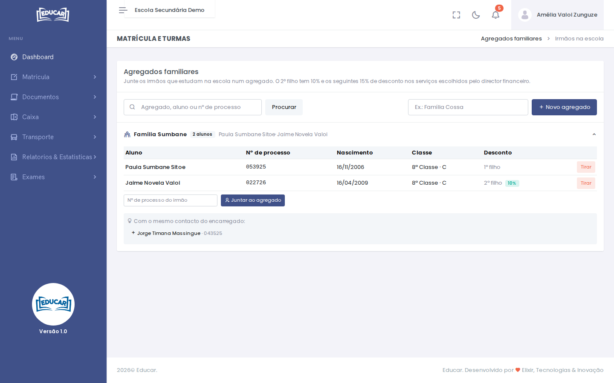

# Agregados familiares

**Menu:** Matrícula e Turmas › Agregados familiares (e Matrícula › Agregados familiares)
**Quem vê:** Chefe da secretaria, Funcionário da secretaria, Director da escola, Director pedagógico, Director financeiro, Funcionário das finanças

Os irmãos que estudam na escola. Com eles num agregado, o 2º filho e os seguintes têm o [desconto de irmãos](../plano-financeiro/desconto-de-irmaos.md) definido pelo director financeiro.

## Criar um agregado

1. Escreva o nome (por exemplo, `Família Cossa`) e use **Novo agregado**.
2. No agregado, escreva o **Nº de processo do irmão** e use **Juntar ao agregado**. Repita para cada irmão.

Por baixo aparecem, como sugestão, os alunos com o mesmo contacto do encarregado de um aluno do agregado: um clique junta-os.

Cada aluno só está num agregado. A tabela mostra a data de nascimento, a classe e o lugar de cada um (**1º filho**, **2º filho**, **3º filho e seguintes**) com a percentagem do desconto. Um aluno sem matrícula activa ou pendente no ano não conta.

## Mudar

- **Tirar** retira um aluno do agregado (deixa de ter o desconto). Um agregado sem alunos apaga-se.
- Procure pelo nome do agregado, pelo nome de um aluno ou pelo nº de processo.
