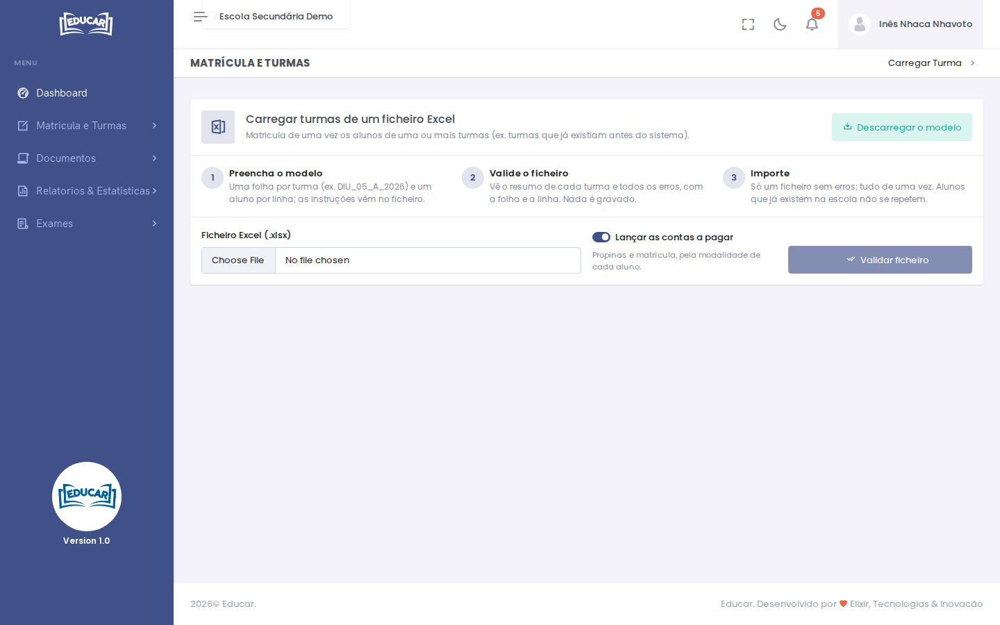

# Carregar Turma

**Menu:** Matrícula e Turmas › Carregar Turma
**Quem vê:** Chefe da secretaria, Director da escola, Director pedagógico

Matricular de uma vez os alunos de uma ou mais turmas a partir de um ficheiro Excel, por exemplo turmas que já existiam antes de a escola usar o sistema.

1. **Preencha o modelo.** Use **Descarregar o modelo**. Cada turma é uma folha (por exemplo, `DIU_05_A_2026`) e cada linha um aluno. As instruções vêm no ficheiro.
2. **Valide o ficheiro.** Escolha o ficheiro e use **Validar ficheiro**. Vê o resumo de cada turma e todos os erros, com a folha e a linha. Nada é gravado.
3. **Importe.** Só um ficheiro sem erros se importa, tudo de uma vez. Os alunos que já existem na escola não se repetem.

Com **Lançar as contas a pagar** ligado, cada aluno fica com as contas das propinas e da matrícula, pela sua modalidade de pagamento.
