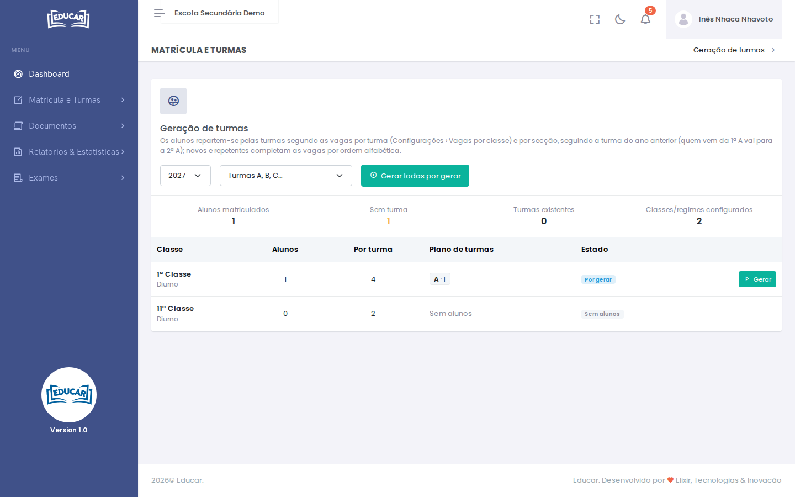

# Geração de Turmas

**Menu:** Matrícula e Turmas › Geração de Turmas
**Quem vê:** Chefe da secretaria, Director da escola, Director pedagógico

Repartir os alunos matriculados pelas turmas, no início do ano.

Os alunos repartem-se segundo as vagas por turma ([Configurações › Vagas por classe](../configuracoes/vagas-por-classe.md)) e por secção. Quem já estava na escola segue a turma do ano anterior (quem vem da 1ª A vai para a 2ª A). Os novos e os repetentes completam as vagas, por ordem alfabética.

1. Escolha o ano e como se chamam as turmas (por exemplo, **Turmas A, B, C…**).
2. Veja, por classe e regime, quantos alunos há, quantos cabem por turma e o **Plano de turmas** (por exemplo, `A·1` é a turma A com 1 aluno).
3. Use **Gerar** numa classe, ou **Gerar todas por gerar**.

O estado de cada classe diz se as turmas estão **Por gerar**, já geradas, ou se a classe está **Sem alunos**.

!!! warning "Só na preparação do ano"
    A geração de turmas fecha quando o ano passa ao 1º trimestre ([Configurações › Ano Académico](../configuracoes/ano-academico.md)).

Depois de geradas as turmas, faça o horário de cada uma em [Pesquisar Turma](pesquisar-turma.md#horario-da-turma).
