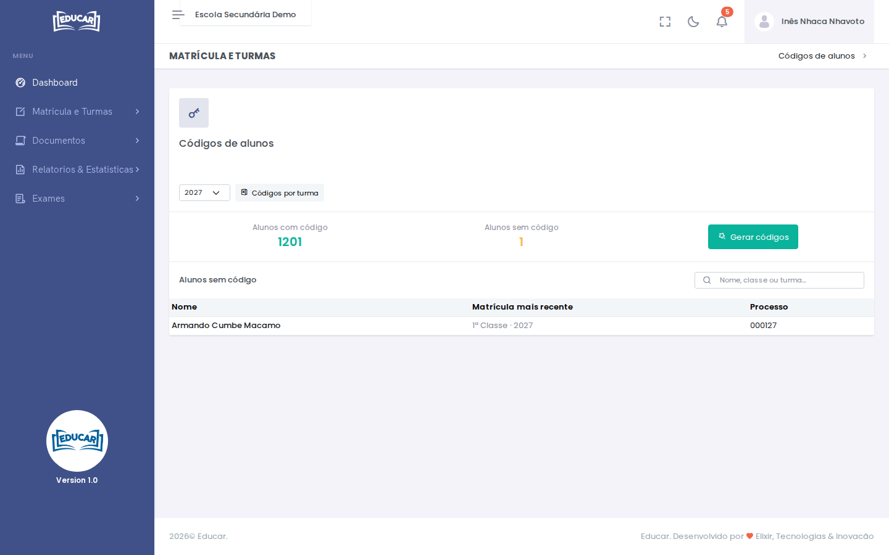

# Gerar códigos de alunos

**Menu:** Matrícula e Turmas › Gerar códigos de alunos
**Quem vê:** Chefe da secretaria, Director da escola, Director pedagógico

O código do aluno é o seu nome de utilizador na área do aluno e na app. Este ecrã gera o código dos alunos que ainda não o têm.

Este ecrã indica também como se forma a senha inicial; entregue-a só ao aluno ou ao encarregado, e peça-lhes que a mudem. Os alunos marcados não têm a ficha completa: complete a data de nascimento na ficha do aluno.

1. Escolha o ano lectivo. Vê quantos alunos têm código e a lista dos que não têm.
2. Use **Gerar códigos**.

**Códigos por turma** descarrega um ficheiro com os códigos dos alunos de cada turma, para os entregar.
