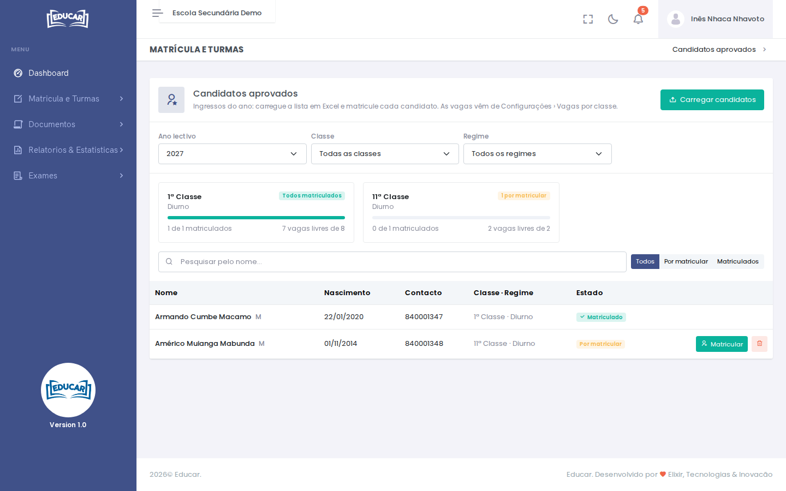
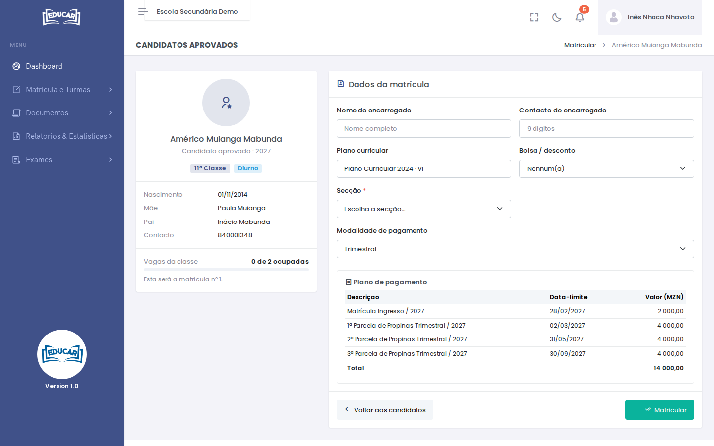

# Novos Ingressos

**Menu:** Matrícula e Turmas › Novos Ingressos
**Quem vê:** Chefe da secretaria, Director da escola, Director pedagógico

Os ingressos do ano: a lista dos candidatos aprovados, carregada de um ficheiro Excel, e a matrícula de cada um. As vagas vêm de [Configurações › Vagas por classe](../configuracoes/vagas-por-classe.md).

Escolha o ano, e se quiser a classe e o regime. Cada cartão mostra uma classe: quantos candidatos já estão matriculados e quantas vagas restam. A lista pode filtrar-se por **Por matricular** e **Matriculados**, e pesquisar-se pelo nome.

## Carregar os candidatos

1. Use **Carregar candidatos** e depois **Descarregar modelo**. O modelo traz uma folha por cada classe com vagas.
2. Preencha uma folha por classe e regime, com o nome `REGIME_CLASSE_ANO`. A primeira linha é o cabeçalho; cada linha seguinte é um candidato, com:
    - o nome completo (nome e apelido);
    - a data de nascimento (dd/mm/aaaa);
    - o nome da mãe e o nome do pai;
    - o contacto (9 dígitos) e um contacto alternativo;
    - o género (M ou F).
3. Escolha o ficheiro e use **Carregar**.

O ano tem de estar aberto na escola. Um candidato que já existe no ano (mesmo nome e data de nascimento) não se repete. Um candidato carregado por engano tira-se com o caixote do lixo.

## Matricular um candidato

1. Na linha do candidato, use **Matricular**.
2. Preencha o nome e o contacto do encarregado.
3. Confirme o plano curricular, e escolha a bolsa ou desconto (se tiver), a secção (nas classes divididas por secções) e a modalidade de pagamento.
4. Veja o **Plano de pagamento**: a matrícula e as parcelas, com as datas-limite e os valores.
5. Use **Matricular**.

O aluno fica matriculado, com as contas lançadas, e entra numa turma na [geração de turmas](geracao-de-turmas.md).
