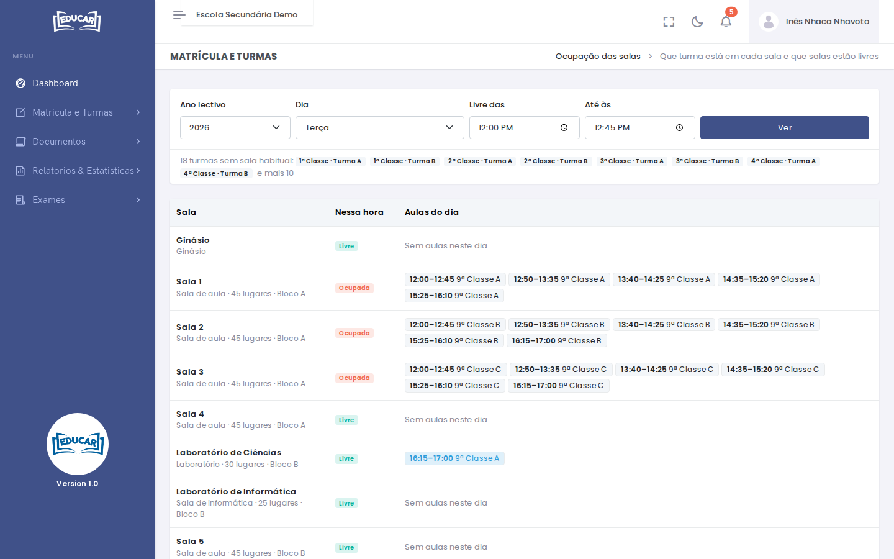

# Ocupação das salas

**Menu:** Matrícula e Turmas › Ocupação das salas
**Quem vê:** Chefe da secretaria, Director da escola, Director pedagógico

Que turma está em cada sala em cada dia, e que salas estão livres.

Escolha o **Ano lectivo** e o **Dia** e use **Ver**. Cada sala mostra as aulas do dia. A azul, as aulas em que a sala foi trocada só nesse tempo.

## Procurar uma sala livre

Preencha **Livre das** e **Até às** e use **Ver**. Cada sala diz se está **Livre** ou **Ocupada** nessa hora.

## Avisos

- **Aulas ao mesmo tempo na mesma sala:** a vermelho. Corrija-as no [horário da turma](pesquisar-turma.md#a-sala-da-turma).
- **Turmas sem sala habitual:** as turmas com horário a que falta escolher a sala. As aulas delas não contam na ocupação, por isso uma sala pode parecer livre sem estar.
