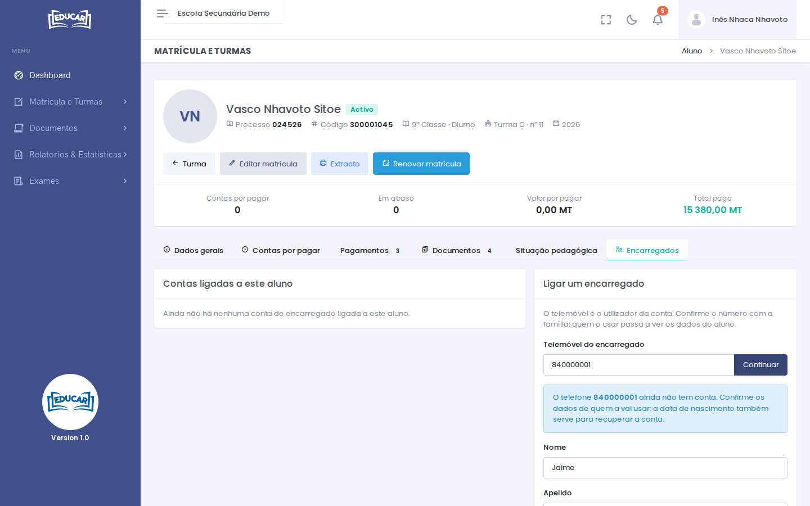

# Pesquisar Turma

**Menu:** Matrícula e Turmas › Pesquisar Turma
**Quem vê:** Chefe da secretaria, Director da escola, Director pedagógico

Encontrar uma turma ou um aluno, e abrir a ficha do aluno.

## Pesquisar

1. Escolha o **Ano lectivo**, a **Classe** e o **Regime**. A **Turma** é opcional.
2. Use **Pesquisar**.

Os botões **Turma A**, **Turma B**… filtram a lista por turma, com o número de alunos. A caixa de pesquisa procura pelo nome, n.º de processo, código ou secção. **Com contas em atraso** mostra só os alunos com contas por pagar fora do prazo.

Cada linha mostra o número do aluno na turma, o processo, o código, a turma, o estado da matrícula e as contas por pagar. Clique no aluno para abrir a ficha.

## Ficha do aluno

O topo mostra os dados do aluno e o resumo das contas: por pagar, em atraso, valor por pagar e total pago. Os separadores:

| Separador | Para quê |
|---|---|
| **Dados gerais** | Dados pessoais e da matrícula; o lápis **Editar** altera-os |
| **Contas por pagar** | Seleccionar contas e registar o pagamento |
| **Pagamentos** | Pagamentos feitos, com o recibo |
| **Documentos** | Pedidos de documentos do aluno (veja [Pedidos de documentos](../documentos/pedidos-de-documentos.md#registar-um-pedido)) |
| **Situação pedagógica** | Médias dos trimestres e fecho do ano do aluno |
| **Encarregados** | Contas de encarregado ligadas ao aluno, para acompanhar na [app](../../primeiros-passos/app.md) (veja [Ligar um encarregado](#ligar-um-encarregado)) |

### Registar um pagamento

1. No separador **Contas por pagar**, marque as contas que o aluno vai pagar. A multa das contas em atraso soma-se sozinha.
2. Em **Registar pagamento**, escolha a conta de entrada, escreva a referência (talão, transferência…) e a data do pagamento.
3. Use **Registar pagamento**. O recibo fica disponível.

Os botões no topo da ficha:

- **Turma** volta à turma;
- **Editar matrícula** altera a classe, a turma e o número, a secção, a bolsa, a modalidade de pagamento e o encarregado;
- **Extracto** mostra o extracto das contas do aluno, para imprimir;
- **Renovar matrícula** aparece no período de renovação.

Estes botões dependem do perfil: as finanças vêem a ficha para receber pagamentos, mas não alteram a matrícula.

### Renovar a matrícula

Dentro do período de renovação ([Calendário Académico](../configuracoes/calendario-academico.md)), use **Renovar matrícula** na ficha do aluno.

1. Confirme o regime, a modalidade de pagamento e a bolsa ou desconto.
2. Use **Salvar**.
3. Registe o pagamento da renovação em **Contas por pagar**.

### Ligar um encarregado

A conta de encarregado é opcional: serve para acompanhar o aluno na app. Crie-a só para as famílias que a quiserem. Sem conta, a matrícula, os pagamentos, os documentos e os exames funcionam da mesma forma, e o aluno continua a usar a sua conta.

O telemóvel é o utilizador da conta. A mesma conta serve para todos os educandos, mesmo noutra escola.

!!! warning "Confirme o número"
    Confirme o telemóvel com a família antes de ligar: quem usar a conta passa a ver as notas, as contas e os outros dados do aluno.

1. Na ficha do aluno, abra o separador **Encarregados**.
2. Em **Telemóvel do encarregado**, confirme ou escreva o número e use **Continuar**.
3. Se o telefone já tem conta, confirme o nome de quem a usa e use **Ligar o aluno a esta conta**.
4. Se o telefone ainda não tem conta, confirme o **Nome** e o **Apelido**, escreva a **Data de nascimento** e escolha o **Sexo**. Use **Criar a conta e ligar o aluno**.
5. Numa conta nova, a mensagem mostra a senha inicial uma só vez. Comunique-a ao encarregado, que a muda na primeira entrada.

Para retirar o acesso, por exemplo quando o encarregado muda, use **Desligar** na lista. A conta deixa logo de ver este aluno, mas continua a ver os outros educandos.

O telemóvel de uma conta não se altera. Se o encarregado mudar de número, desligue a conta antiga e crie uma com o número novo, em cada um dos educandos.

Se o encarregado se esquecer da senha, recupera-a no site do EDUCAR, em **Esqueceu a senha?**, com o telemóvel no lugar do código e os seus dados pessoais. A app ainda não tem esta opção.

## Horário da turma

Com uma turma escolhida, o separador **Horário** mostra o horário da turma.

1. Escolha o **Período de aula** da turma (o turno, de [Períodos Leccionados](../configuracoes/periodos-leccionados.md)).
2. Clique num tempo para escolher ou trocar a disciplina e o professor. O professor não pode ter duas aulas ao mesmo tempo: o horário avisa se tiver aula noutra turma nesse tempo.
3. Escolha o **Director de turma** e o **Chefe de turma**.

!!! warning "Mudar o período"
    Ao mudar o período de aulas da turma, o horário tem de ser refeito.

O resumo dos horários de todas as turmas está em [Configurações › Professores por Turma](../configuracoes/professores-por-turma.md).
