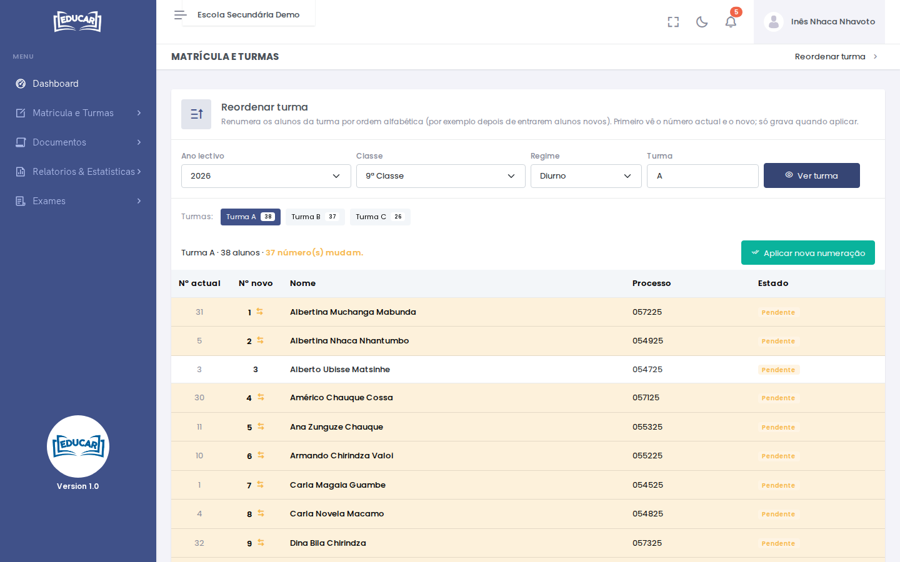

# Reordenar Turma

**Menu:** Matrícula e Turmas › Reordenar Turma
**Quem vê:** Chefe da secretaria, Director da escola, Director pedagógico

Voltar a numerar os alunos de uma turma por ordem alfabética, por exemplo depois de entrarem alunos novos.

1. Escolha o ano lectivo, a classe, o regime e a turma.
2. Use **Ver turma**. A lista mostra o **Nº actual** e o **Nº novo** de cada aluno, e quantos números mudam. Nada fica gravado ainda.
3. Use **Aplicar nova numeração**.

Se a numeração já estiver por ordem alfabética, o ecrã diz.
