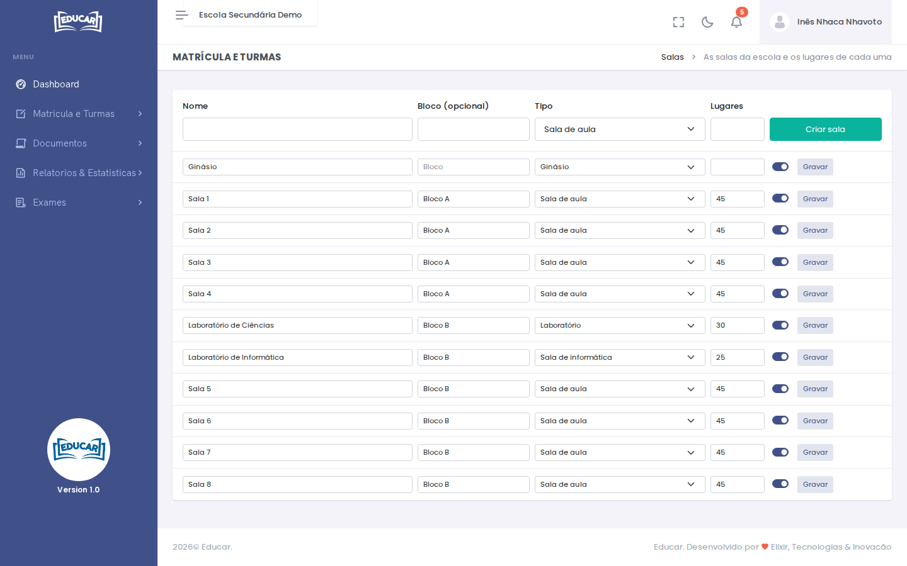

# Salas

**Menu:** Matrícula e Turmas › Salas
**Quem vê:** Chefe da secretaria, Director da escola, Director pedagógico

As salas da escola: salas de aula, laboratórios, ginásio e outros espaços. A sala de cada turma escolhe-se depois, no [horário da turma](pesquisar-turma.md#a-sala-da-turma).

## Criar uma sala

1. Escreva o **Nome**, por exemplo `Sala 12`.
2. Escreva o **Bloco**, se a escola os tiver.
3. Escolha o **Tipo**.
4. Em **Lugares**, indique quantos alunos cabem na sala. Serve para avisar quando uma turma é maior do que a sala.
5. Use **Criar sala**.

## Alterar ou desligar

Altere os dados na linha da sala e use **Gravar**. Desligue o interruptor para deixar de usar uma sala, por exemplo durante obras: deixa de aparecer nas listas, mas as turmas que já a têm mantêm-na, por isso escolha outra sala para elas.

## As salas e o património

As salas são também os [locais do património](../patrimonio/categorias-e-locais.md#locais). Se já existir um local com o mesmo nome, por exemplo `Sala 1`, passa a ser uma sala e os bens que lá estão continuam lá.
