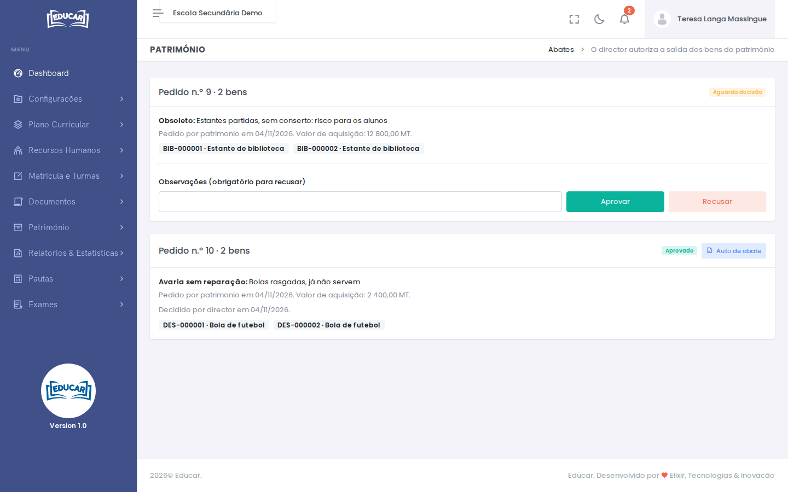
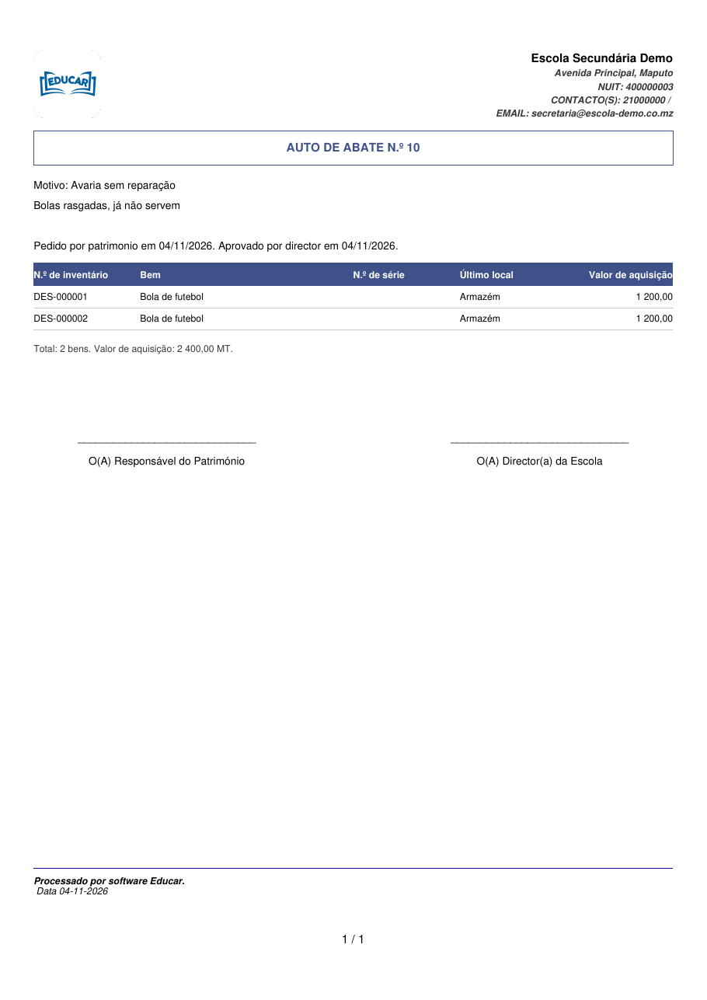

# Abates

**Menu:** Património › Abates
**Quem vê:** Gestor do património, Director, Director pedagógico, Director financeiro, Funcionário das finanças

O abate tira um bem do património da escola: partiu-se sem conserto, perdeu-se, foi roubado, vendido, doado ou já não serve. O gestor do património ou o director pedem o abate, e só o **director** o autoriza.

## Pedir um abate

1. Em [Bens](bens.md), marque os bens na lista e use **Pedir abate dos escolhidos**. Para um só bem, também pode usar **Pedir abate** na ficha.
2. Escolha o **Motivo** e explique o que aconteceu.
3. Use **Pedir abate**.

O director recebe um [aviso](../../primeiros-passos/avisos.md). Enquanto espera, os bens não se transferem nem se emprestam.

Um bem emprestado ou com uma avaria em aberto não entra no pedido: registe primeiro a devolução ou conclua a avaria.

## Decidir (director)

O director decide o pedido inteiro. Para aprovar só parte dos bens, recuse o pedido e explique o que deve ser pedido de novo.

- **Aprovar:** os bens saem das listas e dos totais. A decisão não se desfaz.
- **Recusar:** escreva o motivo nas **Observações**. Os bens continuam no património, como estavam.

Quem pediu recebe um aviso com a decisão, se tiver o perfil de gestor do património.

## Auto de abate

Num pedido aprovado, use **Auto de abate** para imprimir o documento, com os bens, o motivo, as datas e as assinaturas. Guarde a cópia assinada.

Os bens abatidos não desaparecem: a ficha e o histórico continuam disponíveis, a partir do pedido.
