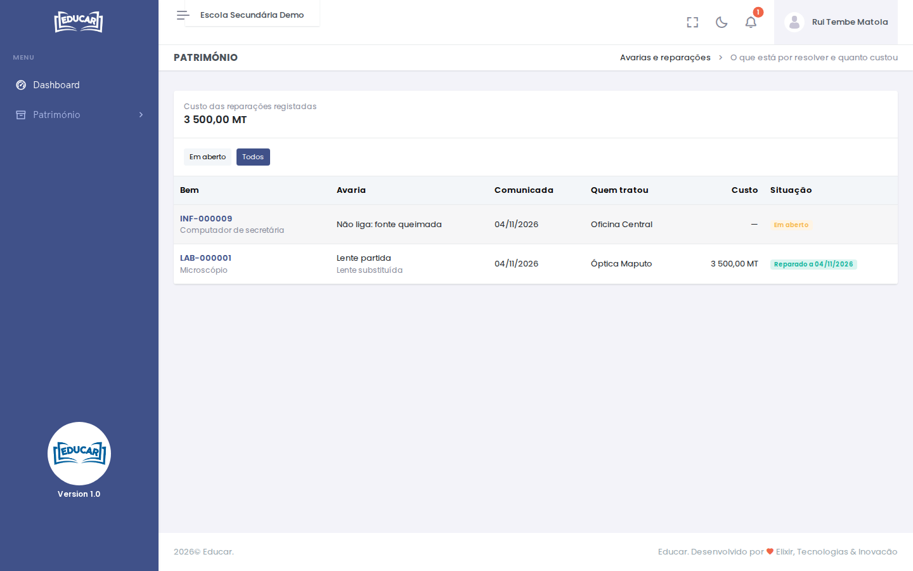

# Avarias e reparações

**Menu:** Património › Avarias e reparações
**Quem vê:** Gestor do património, Director, Director pedagógico, Director financeiro, Funcionário das finanças

As avarias por resolver e o que aconteceu às outras. O topo soma o custo das reparações registadas. **Em aberto** mostra as que faltam concluir e **Todos** mostra também as concluídas.

As avarias registam-se na ficha do bem. O gestor do património e o director podem fazê-lo; os outros perfis consultam.

## Comunicar uma avaria

1. Em [Bens](bens.md), abra a ficha do bem e use **Comunicar uma avaria**.
2. Escreva o que aconteceu e, se já souber, quem vai tratar.
3. Use **Registar a avaria**.

O bem passa logo a **Avariado** e não se pode emprestar.

## Concluir

Na ficha do bem, escolha o **Resultado** e use **Concluir**:

- **Reparado:** escolha o estado em que o bem ficou. Pode registar o custo e quem tratou.
- **Sem reparação:** explique porquê. O bem continua avariado e, se já não servir, pode [pedir o abate](abates.md).

O custo fica só aqui: registar uma reparação não cria uma despesa. O pagamento regista-se em [Receitas e Despesas](../tesouraria/receitas-e-despesas.md).
