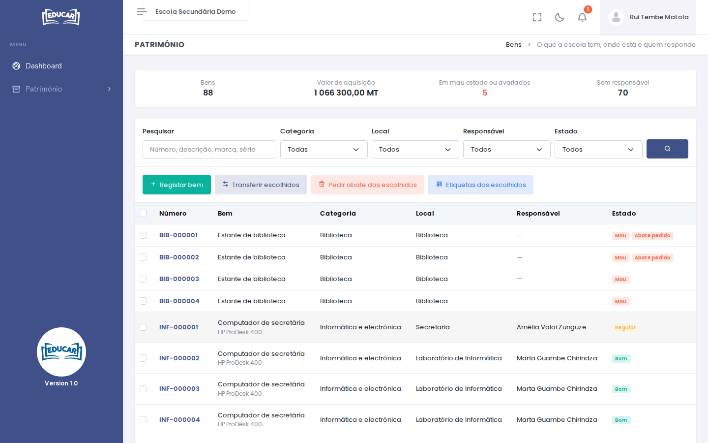
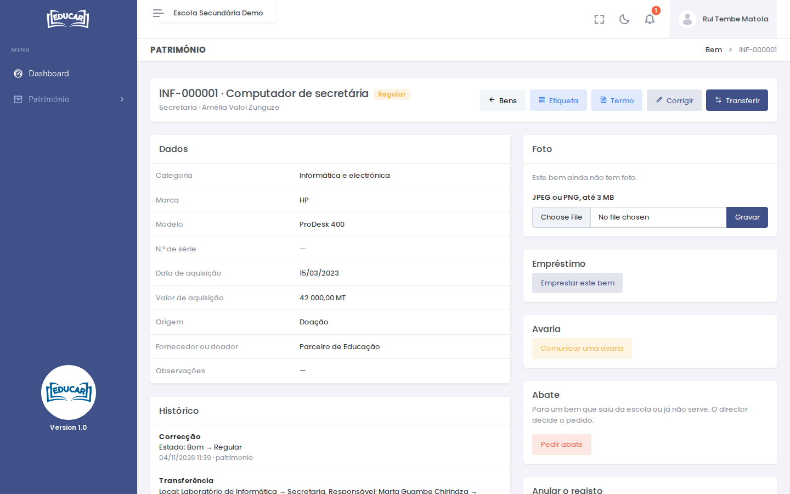
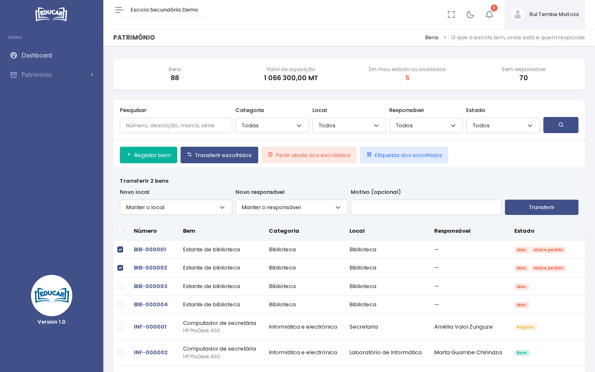
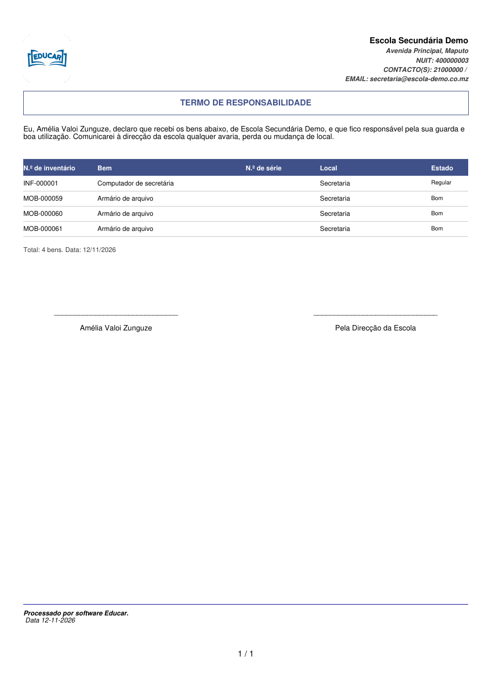

# Bens

**Menu:** Património › Bens
**Quem vê:** Gestor do património, Director, Director pedagógico, Director financeiro, Funcionário das finanças

Todos os bens da escola. O topo soma os bens do filtro, o valor de aquisição, os que estão em mau estado ou avariados e os que não têm responsável.

Só o gestor do património e o director alteram os bens. Os outros perfis consultam a lista e imprimem etiquetas e termos.

## Procurar

Pesquise pelo número, pela descrição, pela marca, pelo modelo ou pelo número de série. Também pode filtrar por **Categoria**, **Local**, **Responsável** e **Estado**.

## Ficha do bem

Clique no número para abrir a ficha, com os dados, a foto e o histórico. O histórico mostra tudo o que aconteceu ao bem, quem o fez e quando, e não se apaga.

Na ficha pode:

- usar **Corrigir** para alterar os dados, incluindo o estado do bem;
- gravar uma foto, em JPEG ou PNG, até 3 MB;
- usar **Transferir**, **Etiqueta** e **Termo**;
- registar um [empréstimo](emprestimos.md) ou uma [avaria](avarias-e-reparacoes.md);
- pedir o [abate](abates.md).

A categoria não se corrige, porque faz parte do número. Se a categoria estiver errada, anule o registo e registe o bem de novo.

### Anular um registo

Use **Anular o registo** só para um registo feito por engano, e indique o motivo. O bem sai das listas, mas a ficha e o histórico ficam.

Um bem que saiu da escola de verdade não se anula: peça o [abate](abates.md). Também não se anula um bem emprestado, com uma avaria em aberto ou com um pedido de abate.

## Transferir bens

Serve para mudar o local, o responsável, ou ambos.

1. Marque os bens na lista.
2. Use **Transferir escolhidos**.
3. Escolha o **Novo local** e/ou o **Novo responsável**. Os bens podem ficar **Sem responsável**.
4. Escreva o motivo, se quiser, e use **Transferir**.

A transferência fica no histórico de cada bem. Se escolheu um novo responsável, a seguir pode imprimir o termo.

Um bem emprestado ou com um pedido de abate não se transfere. Se estiver entre os escolhidos, a mensagem diz qual é, e não muda nenhum dos bens.

Só aparecem como responsáveis os docentes, os funcionários com conta e as pessoas registadas pela escola em [Pessoas](../recursos-humanos/pessoas.md).

## Imprimir etiquetas

Marque os bens na lista e use **Etiquetas dos escolhidos**, até 500 de cada vez. Cada etiqueta tem o nome da escola, o número, a descrição e um QR com o número. A folha é A4, com três etiquetas por linha.

## Termo de responsabilidade

O termo lista todos os bens à guarda de uma pessoa, para ela assinar.

1. Em **Responsável**, escolha a pessoa e filtre a lista.
2. Use **Termo de responsabilidade**.
3. Imprima o termo e guarde a cópia assinada.

Depois de mudar os bens de uma pessoa, imprima um termo novo: o sistema não guarda os termos assinados.
