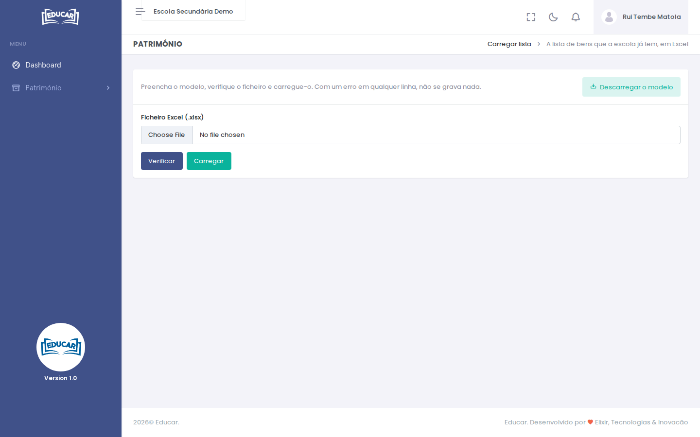

# Carregar lista

**Menu:** Património › Carregar lista
**Quem vê:** Gestor do património, Director

Para trazer de uma só vez a lista de bens que a escola já tem em Excel.

1. Use **Descarregar o modelo**. A segunda folha do modelo explica cada coluna e tem as siglas das categorias da escola.
2. Preencha uma linha por bem, ou por grupo de bens iguais, com a **Quantidade**. Apague a linha de exemplo.
3. Escolha o ficheiro e use **Verificar**. O sistema mostra quantos bens encontrou e os locais novos, ou os erros, com o número da linha. Nada fica gravado.
4. Corrija o que for preciso e use **Carregar**.

Com um erro em qualquer linha, não se grava nada.

!!! warning "Antes de carregar"
    Verifique sempre o ficheiro. Os bens carregados só se retiram um a um, com [Anular o registo](bens.md#anular-um-registo). Carregar duas vezes o mesmo ficheiro regista os bens duas vezes.

Os locais que ainda não existem criam-se ao carregar, por isso escreva-os sempre da mesma forma. Os responsáveis indicam-se depois, com [Transferir](bens.md#transferir-bens). Pode carregar até 5000 bens de cada vez.
