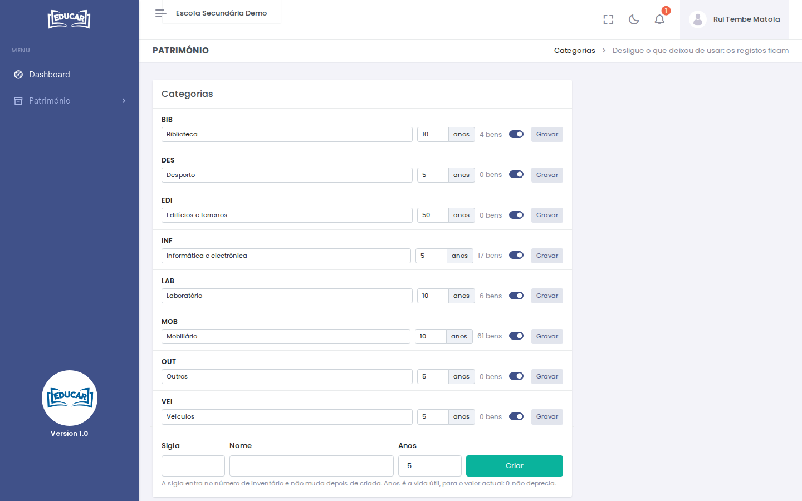

# Categorias

**Menu:** Património › Categorias
**Quem vê:** Gestor do património, Director

As categorias agrupam os bens. Os sítios onde os bens estão registam-se em [Locais](locais.md).

A escola começa com estas categorias: Mobiliário, Informática e electrónica, Laboratório, Biblioteca, Desporto, Veículos, Edifícios e terrenos, Outros.

Para criar outra, escreva a **Sigla**, de 2 a 5 letras sem acentos, o **Nome** e os **Anos**, e use **Criar**. A sigla entra no número de inventário e não muda depois de criada.

Os **Anos** são a vida útil da categoria: em quantos anos o [valor actual](mapas-e-valor.md#valor-actual) dos bens chega a zero. Com 0, a categoria não se deprecia, por exemplo para os terrenos. O sistema começa com valores propostos, que a escola pode mudar: não são taxas oficiais. Confirme-os com quem trata da contabilidade.

## Alterar ou desligar

Altere o nome na linha e use **Gravar**. Desligue o interruptor para deixar de usar uma categoria: deixa de aparecer ao registar, mas os bens que já a têm mantêm-se.
