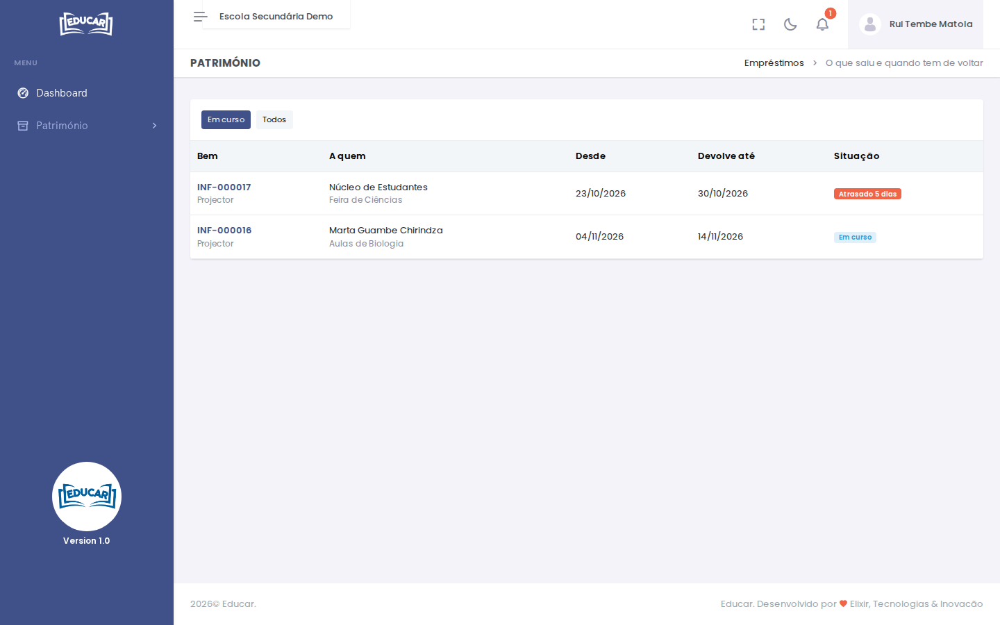
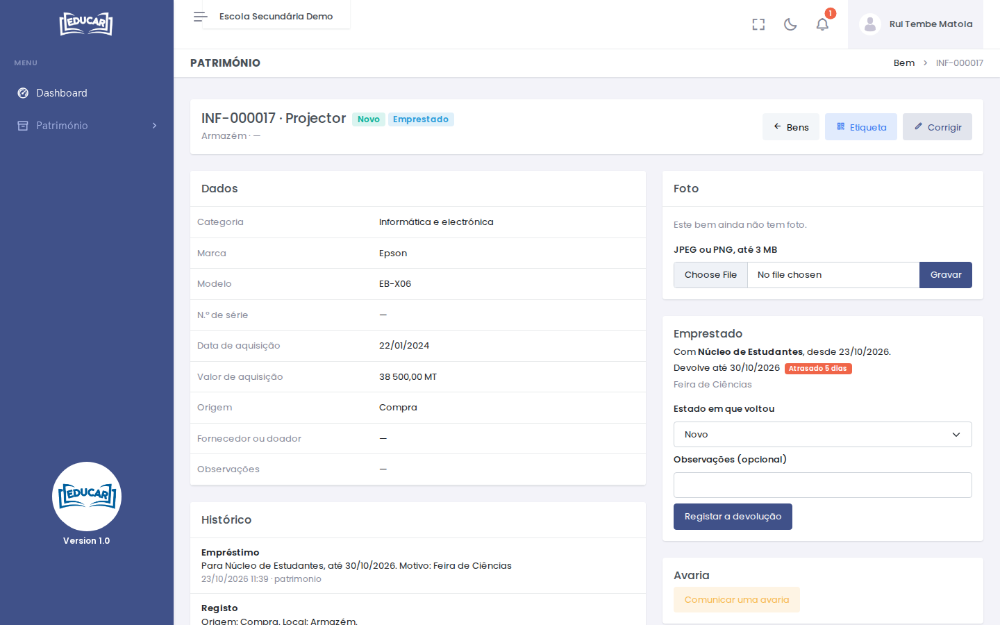

# Empréstimos

**Menu:** Património › Empréstimos
**Quem vê:** Gestor do património, Director, Director pedagógico, Director financeiro, Funcionário das finanças

Os bens que saíram por algum tempo e quando têm de voltar. **Em curso** mostra os que ainda não voltaram, com os mais atrasados primeiro. **Todos** mostra também os devolvidos.

Os empréstimos registam-se na ficha do bem. O gestor do património e o director podem fazê-lo; os outros perfis consultam.

## Emprestar um bem

1. Em [Bens](bens.md), abra a ficha do bem e use **Emprestar este bem**.
2. Em **A quem**, escolha a pessoa. Para alguém que não está na lista, deixe **Outra pessoa** e escreva o **Nome**.
3. Em **Devolve até**, indique a data. O **Motivo** é opcional.
4. Use **Registar o empréstimo**.

Um bem avariado ou com um pedido de abate não se empresta. Enquanto estiver emprestado, o bem não muda de local nem de responsável.

## Registar a devolução

Na ficha do bem, confirme o **Estado em que voltou**, escreva as observações, se as houver, e use **Registar a devolução**. Se o estado mudou, a mudança fica no histórico.

## Avisos de atraso

Se o bem passar da data, o gestor do património e o director recebem um [aviso](../../primeiros-passos/avisos.md). O aviso repete-se de 7 em 7 dias enquanto o bem não voltar e deixa de contar quando se regista a devolução.
