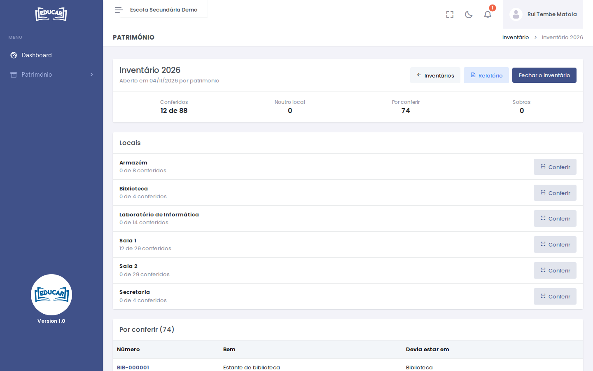
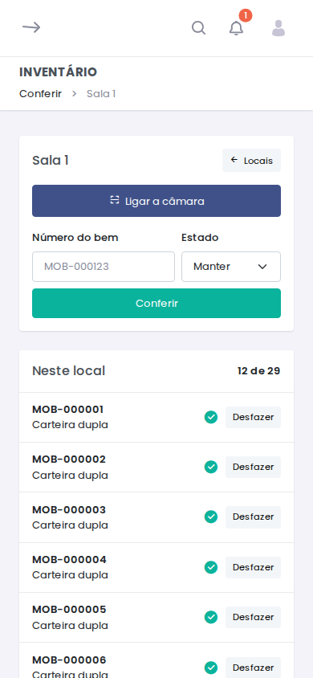
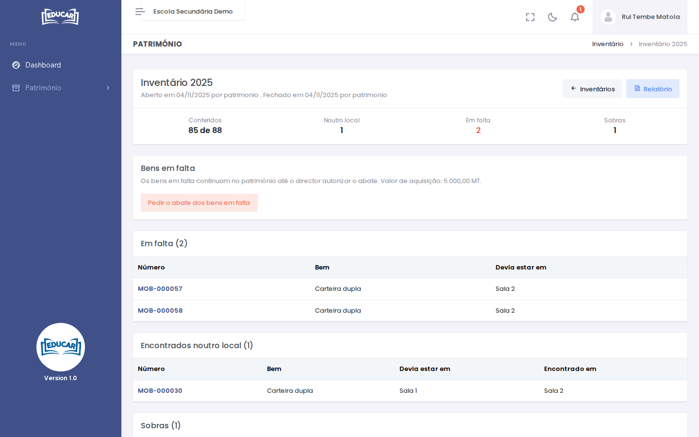
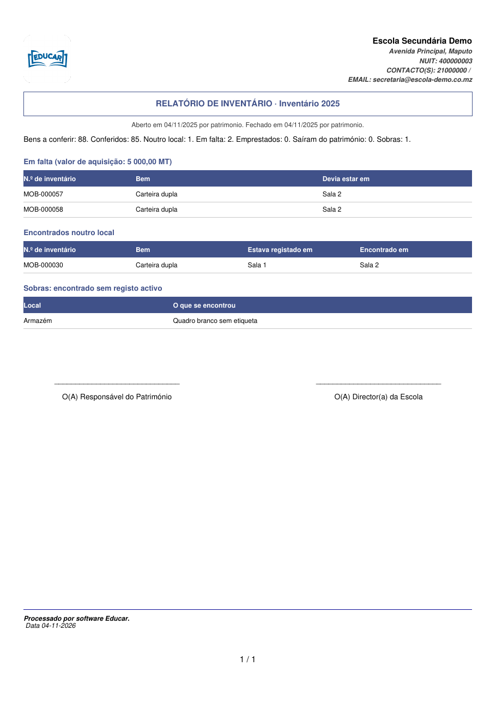

# Inventário

**Menu:** Património › Inventário
**Quem vê:** Gestor do património, Director, Director pedagógico, Director financeiro, Funcionário das finanças

O inventário confere, sala a sala, o que a escola tem. O gestor do património e o director fazem-no; os outros perfis consultam os resultados.

Só pode haver uma campanha aberta de cada vez.

## Abrir a campanha

Escreva o título, por exemplo `Inventário 2026`, e use **Abrir inventário**. Todos os bens activos ficam por conferir. A escola continua a trabalhar normalmente: os empréstimos e as transferências podem continuar.

## Conferir um local

No local, abra o sistema no telemóvel, no navegador, e use **Conferir** na linha do local.

{ width="320" }

Cada bem pode ser conferido de três formas:

- **Com a câmara:** use **Ligar a câmara**, autorize-a e aponte para o QR da etiqueta. O telemóvel lê um bem atrás do outro. Só funciona se o endereço do sistema começar por `https`.
- **À mão:** escreva o número da etiqueta em **Número do bem** e use **Conferir**. Também serve para uma etiqueta estragada ou um leitor ligado ao computador.
- **Na lista:** use **Conferir** na linha do bem. Serve para um bem ainda sem etiqueta.

Depois de cada leitura, a mensagem diz o que aconteceu:

| Mensagem | O que significa |
|---|---|
| Conferido | O bem está onde devia |
| Estava registado noutro local | Ao fechar a campanha, o bem passa para este local |
| Conferido, mas está emprestado ou tem um pedido de abate | Fica conferido, mas o local e o estado não mudam |
| Não é um bem desta escola, ou está abatido ou anulado | Nada muda: se o bem está mesmo aí, registe-o como sobra |

Se o bem está em pior estado, escolha o **Estado** antes de o conferir. Se conferiu por engano, use **Desfazer**.

### Sobras

Uma sobra é um bem que está no local e não corresponde a um bem activo, por exemplo uma cadeira sem etiqueta. Descreva-a em **Sobras neste local** e use **Registar**. Depois do inventário, registe-a em [Registar bem](registar-bem.md).

Um local vazio também aparece na lista, para o caso de ter lá bens que estavam registados noutro sítio.

## Fechar a campanha

Quando acabar, use **Fechar o inventário**. Esta acção não se desfaz:

- os bens encontrados noutro local passam para esse local;
- os estados escolhidos actualizam-se;
- os bens por conferir ficam **em falta**, exceto os emprestados;
- o resultado fica guardado e o director recebe um aviso.

Os bens emprestados ou com um pedido de abate mantêm o local e o estado.

## Bens em falta

Fechar a campanha não abate nada: os bens em falta continuam no património. Procure-os e, se não aparecerem, use **Pedir o abate dos bens em falta** e escreva o que apurou. O [director decide](abates.md#decidir-director). Os bens que estiverem emprestados, com uma avaria em aberto ou já com um pedido ficam de fora do pedido.

## Relatório

**Relatório** mostra os totais, o que falta, o que estava noutro local e as sobras, para assinar e guardar. Com a campanha aberta, o resultado é provisório.

