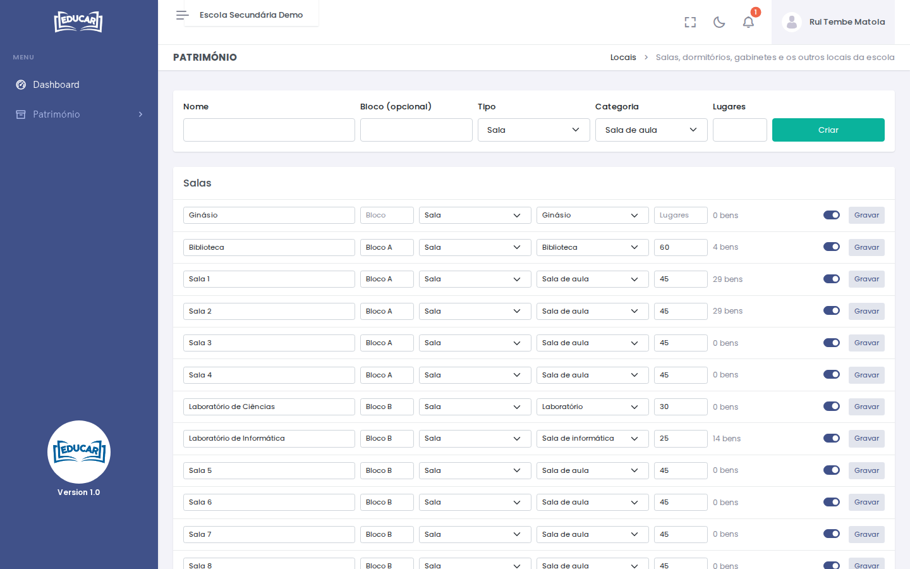

# Locais

**Menu:** Património › Locais
**Quem vê:** Gestor do património, Director

Todos os locais da escola estão numa só lista, cada um com o seu tipo. O mesmo local serve para os bens do património e, se for uma sala, para os horários.

## Criar um local

1. Escreva o **Nome**, por exemplo `Sala 12`.
2. Escreva o **Bloco**, se a escola os tiver.
3. Escolha o **Tipo**. Os campos seguintes mudam com o tipo.
4. Use **Criar**.

| Tipo | O que mais pede | Para que serve |
|---|---|---|
| **Sala** | **Categoria** e **Lugares** | Horários, ocupação, júris de exame e bens |
| **Dormitório** | Nada: os lugares são a soma dos quartos | Bens |
| **Quarto** | **Dormitório** e **Lugares** | Bens |
| **Gabinete**, **Cantina**, **Secretaria**, **Armazém**, **Outro** | Nada | Bens |

## Salas

A **Categoria** diz que espaço é: sala de aula, laboratório, sala de informática, ginásio, biblioteca, auditório ou outro.

Em **Lugares**, indique quantos alunos cabem. Serve para avisar quando uma turma é maior do que a sala.

Só os locais do tipo Sala aparecem no [horário da turma](../matricula-e-turmas/pesquisar-turma.md#a-sala-da-turma), que é onde se escolhe a sala de cada turma.

## Dormitórios e quartos

1. Crie primeiro o dormitório.
2. Crie cada quarto com o tipo **Quarto**, escolha o **Dormitório** e indique os **Lugares**.

Dois dormitórios podem ter um `Quarto 1`, porque o nome completo inclui o dormitório, por exemplo `Dormitório Feminino › Quarto 1`. É esse nome que aparece nos bens e nos mapas.

Aqui só se registam os dormitórios e os quartos. O sistema não coloca alunos nos quartos.

## Alterar ou desligar

Altere os dados na linha do local e use **Gravar**. Se mudar o nome de um dormitório, os seus quartos acompanham.

Desligue o interruptor para deixar de usar um local, por exemplo durante obras:

- O local deixa de aparecer nas listas, mas os bens que lá estão mantêm-se.
- As turmas que já têm essa sala mantêm-na, por isso escolha outra sala para elas.
- Desligar um dormitório desliga também os quartos. Ao voltar a ligar o dormitório, ligue os quartos um a um.

## Mudar o tipo

Pode mudar o tipo de um local na sua linha, excepto em dois casos:

- **Uma sala que está num horário.** Escolha primeiro outra sala no horário.
- **Um dormitório com quartos.** Mude primeiro os quartos para outro dormitório.

Os locais criados antes de haver tipos, ou ao [carregar a lista de bens](carregar-lista.md), ficam como **Outro**. Escolha o tipo certo na linha de cada um.
