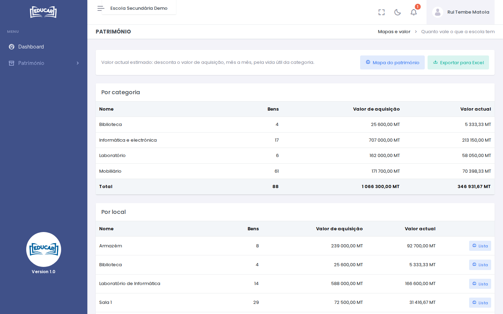

# Mapas e valor

**Menu:** Património › Mapas e valor
**Quem vê:** Gestor do património, Director, Director pedagógico, Director financeiro, Funcionário das finanças

Quantos bens a escola tem e quanto valem, por categoria e por local, e os bens abatidos.

- **Mapa do património** imprime os totais por categoria e por local.
- **Lista**, na linha de cada local, imprime os bens desse local, por exemplo para afixar na sala.
- **Exportar para Excel** descarrega todos os bens activos e os abatidos.

## Valor actual

O valor actual é uma estimativa: o valor de aquisição desce todos os meses, em partes iguais, até chegar a zero no fim da [vida útil da categoria](categorias-e-locais.md#categorias).

Por exemplo, um computador de 120 000,00 MT numa categoria com 5 anos de vida útil vale 72 000,00 MT ao fim de 2 anos.

O valor actual só se calcula quando o bem tem data e valor de aquisição, e numa categoria com vida útil. O ecrã indica quantos bens ficaram de fora do cálculo, por isso preencha estes dados para o total ser fiel.

!!! warning "Uma estimativa"
    O valor actual ajuda a acompanhar o património, mas não substitui a contabilidade da escola. Confirme a vida útil com quem trata das contas.
