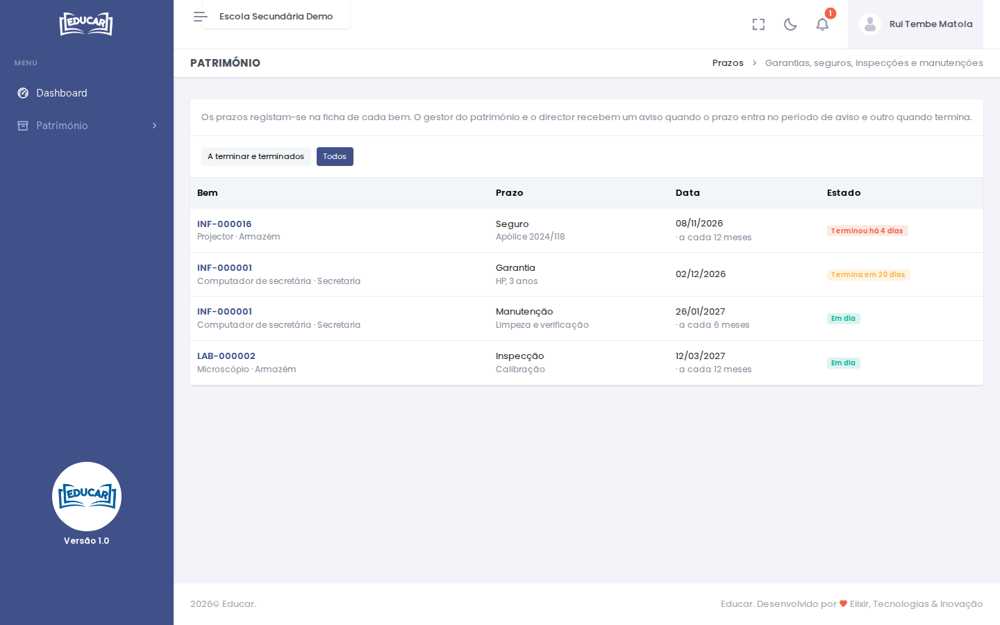
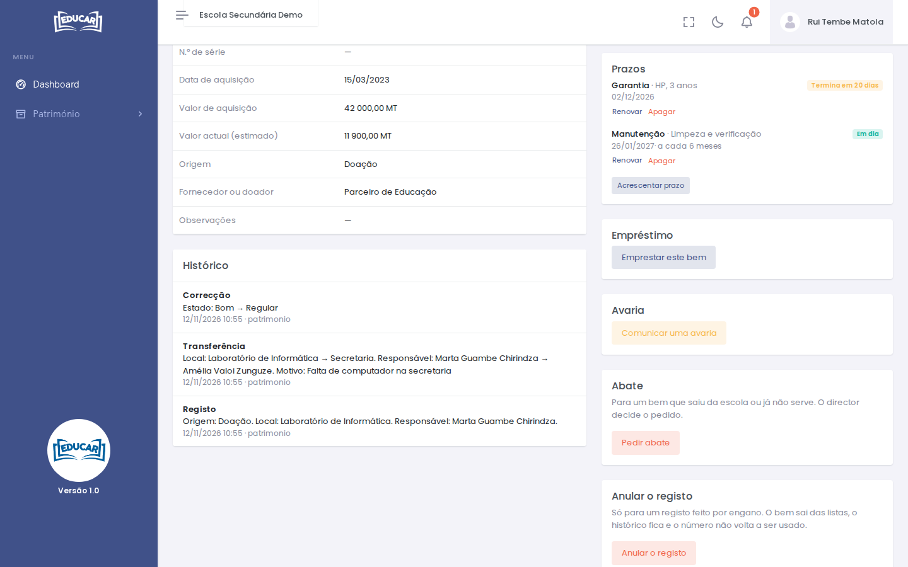

# Prazos

**Menu:** Património › Prazos
**Quem vê:** Gestor do património, Director, Director pedagógico, Director financeiro, Funcionário das finanças

As datas que não se podem deixar passar: o fim de uma garantia ou de um seguro, a próxima inspecção (extintores, viaturas), a manutenção periódica (limpeza de computadores, revisão de geradores), uma licença.

A lista mostra os prazos dos bens activos, pela data. **A terminar e terminados** mostra só os que já estão no aviso e os que já passaram; **Todos** mostra também os que estão em dia.

Cada prazo tem um estado:

- **Em dia**, quando ainda falta mais do que o período de aviso;
- **Termina em N dias**, quando já está no aviso;
- **Terminou há N dias**, quando a data já passou.

## Avisos

O gestor do património e o director recebem dois avisos no sino, e por email se a escola os enviar:

1. quando o prazo entra no período de aviso (por omissão, 30 dias antes);
2. quando o prazo termina.

Cada aviso segue uma só vez. Renovar ou apagar o prazo dá os avisos por tratados.

## Registar um prazo

Os prazos registam-se na ficha do bem, em [Bens](bens.md). O gestor do património e o director podem fazê-lo; os outros perfis consultam.

1. Abra a ficha do bem e, no quadro **Prazos**, use **Acrescentar prazo**.
2. Escolha o **Tipo**: garantia, seguro, inspecção, manutenção, licença ou outro prazo.
3. Escreva uma **Descrição**, se ajudar, por exemplo o número da apólice e a seguradora.
4. Indique a data em **Termina em**.
5. Em **Repete**, escolha se o prazo é de uma só vez ou volta a cada 1, 3, 6, 12, 24 ou 36 meses.
6. Em **Avisar (dias antes)**, mude os 30 dias se precisar de mais ou menos tempo.
7. Use **Registar o prazo**.

Pode registar um prazo que já passou, por exemplo um seguro que ficou por renovar: o aviso de prazo terminado segue logo.

## Renovar

Quando o seguro é renovado ou a manutenção é feita, use **Renovar** no prazo e grave a nova data. Num prazo que se repete, a data proposta já é a seguinte (por exemplo, um ano depois). A nova data tem de ser depois da actual, e os avisos voltam a ficar armados.

Se o prazo já não se aplica, por exemplo uma garantia de um bem que já não tem garantia, use **Apagar**.

Um bem anulado ou abatido sai da lista e deixa de dar avisos.
