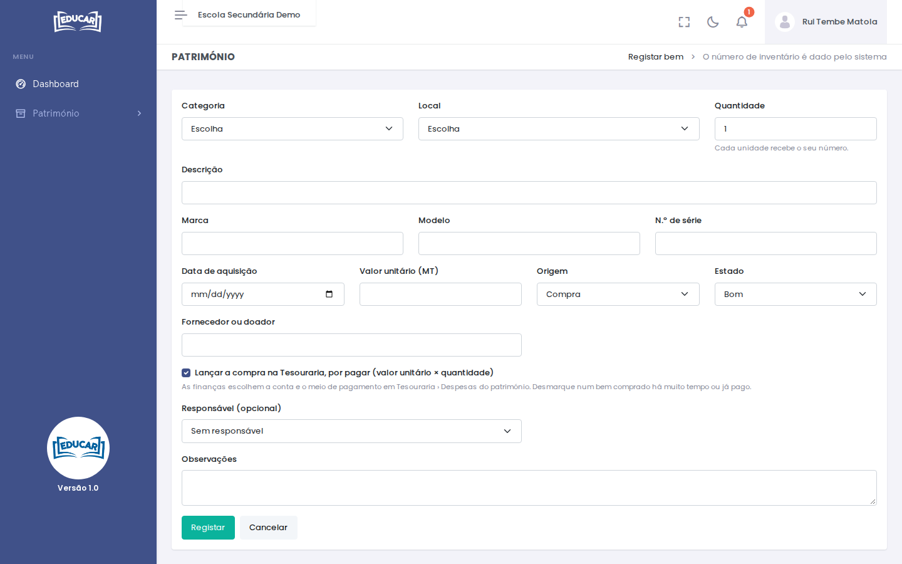

# Registar bem

**Menu:** Património › Registar bem
**Quem vê:** Gestor do património, Director

Para registar um bem, ou vários iguais de uma só vez.

1. Escolha a **Categoria** e o **Local**. Os locais criam-se em [Locais](locais.md).
2. Em **Quantidade**, indique quantos bens iguais vai registar, até 500. Cada unidade recebe o seu número.
3. Escreva a **Descrição**. Os outros dados ajudam a identificar o bem, mas são opcionais: marca, modelo, número de série, data e valor de aquisição, fornecedor ou doador.
4. Escolha a **Origem** e o **Estado**.
5. Numa compra com valor, deixe marcada a opção **Lançar a compra na Tesouraria** (ver abaixo).
6. Se já sabe quem responde pelos bens, escolha o **Responsável**.
7. Use **Registar**.

A mensagem mostra os números dados, e pode logo imprimir as etiquetas.

!!! note "Número de série"
    O número de série é de uma só unidade: só se escreve com a quantidade 1.

O **Valor unitário** é o de cada unidade.

## A compra na Tesouraria

Com a origem **Compra**, aparece a opção **Lançar a compra na Tesouraria, por pagar**, já marcada. Com ela, a compra fica à espera das finanças em [Despesas do Património](../tesouraria/despesas-do-patrimonio.md), com o valor unitário vezes a quantidade. As finanças escolhem a conta e o meio de pagamento e pagam; só então o dinheiro sai do saldo.

Desmarque a opção num bem comprado há muito tempo ou já pago, para não pagar duas vezes. Os bens [carregados por Excel](carregar-lista.md) não criam despesas.

Na ficha do bem, o quadro **Tesouraria** mostra a compra e se já foi paga.
