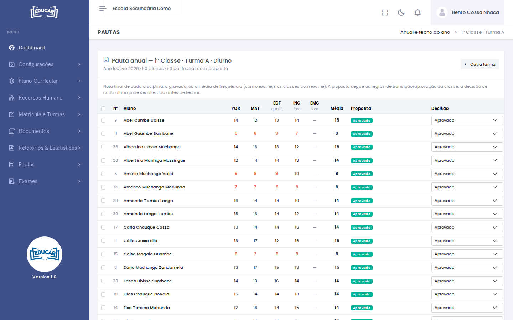

# Anual e fecho do ano

**Menu:** Pautas › Anual e fecho do ano
**Quem vê:** Director da escola, Director pedagógico

A pauta anual de uma turma, com a nota final de cada disciplina e a proposta de cada aluno, e o fecho do ano: aprovado ou reprovado.

1. Escolha o ano lectivo, a classe, o regime e a turma.
2. Use **Abrir**.

## A pauta

- **Nota final de cada disciplina**: a gravada, ou a média de frequência. Nas classes com exame, entra também o exame.
- As disciplinas marcadas **qualit.** têm nota qualitativa; as marcadas **fora** não entram na média.
- **Média**: a média das disciplinas.
- **Proposta**: a decisão que as regras de transição/aprovação da classe propõem (do plano curricular). Pode ser **Aprovado**, **Reprovado**, **A aguardar exames** (nas classes com exame, até ao resultado dos exames), **Sem regras** ou **Sem notas**.
- **Decisão**: começa igual à proposta e pode ser mudada, aluno a aluno, antes de fechar.

!!! warning "3º trimestre por fechar"
    Enquanto a turma não fechar o 3º trimestre, a pauta avisa: as notas finais e as propostas só ficam completas depois disso.

## Fechar o ano

1. Marque os alunos a fechar. A caixa no cabeçalho marca todos os que se podem fechar (da secção filtrada).
2. Confirme a **Decisão** de cada um.
3. Use **Fechar o ano dos seleccionados** e confirme.

As notas finais e a decisão ficam gravadas, e a renovação de cada aluno é acertada: o aprovado renova para a classe seguinte e o reprovado fica na mesma classe.

O ano de um aluno também se fecha na sua ficha, no separador **Situação pedagógica** ([Pesquisar Turma](../matricula-e-turmas/pesquisar-turma.md#ficha-do-aluno)).
