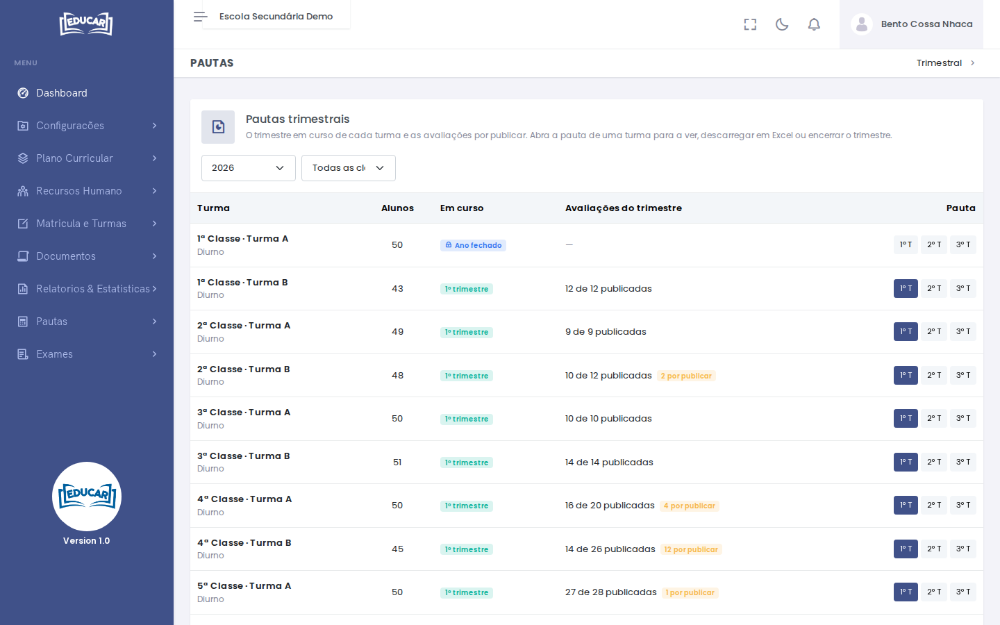

# Trimestral

**Menu:** Pautas › Trimestral
**Quem vê:** Director da escola, Director pedagógico

O trimestre em curso de cada turma e as avaliações por publicar. Daqui abre-se a pauta trimestral de uma turma, para a ver, a descarregar em Excel ou encerrar o trimestre.

1. Escolha o ano lectivo e, se quiser, a classe.
2. Veja, em cada turma, o trimestre **Em curso** e quantas avaliações do trimestre estão publicadas. As que faltam aparecem como **por publicar**.
3. Use **1º T**, **2º T** ou **3º T** para abrir a pauta desse trimestre.

## A pauta do trimestre

A pauta mostra o total de alunos, homens e mulheres, quantos têm média positiva e negativa, e a média geral. Por baixo, os resultados de cada aluno por disciplina: a média das avaliações (M.ACS), a nota do trimestre e a média final. Nas classes com secções, filtre por secção.

- **Baixar Pauta (Excel)** descarrega a pauta.
- **Encerrar Trimestre** fecha o trimestre da turma. Depois de encerrado, as notas desse trimestre só se consultam.

As notas vêm das avaliações que os professores publicam em [Professor › As minhas turmas](../professor/as-minhas-turmas.md).
