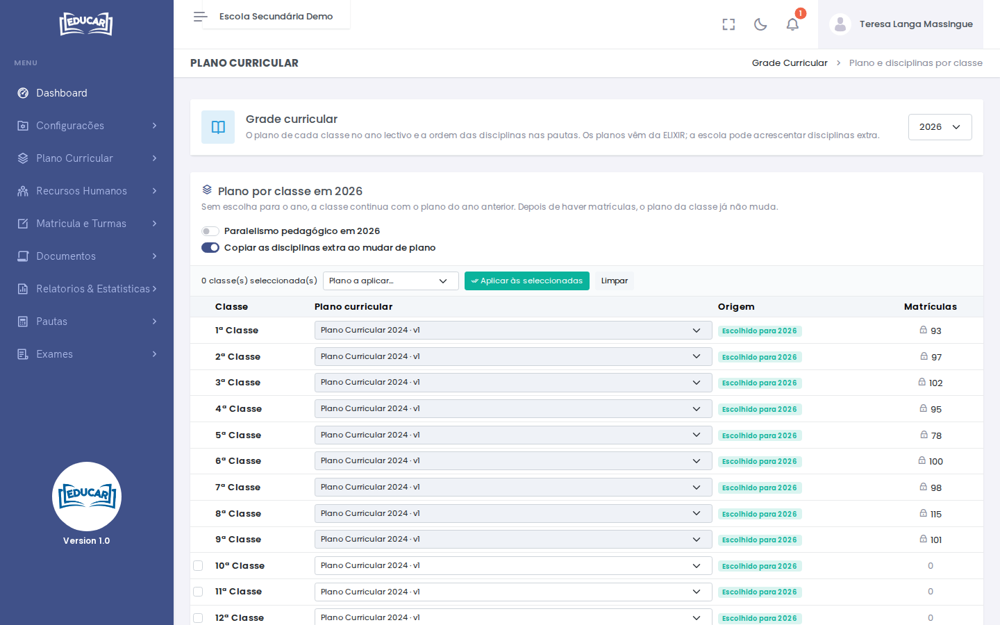
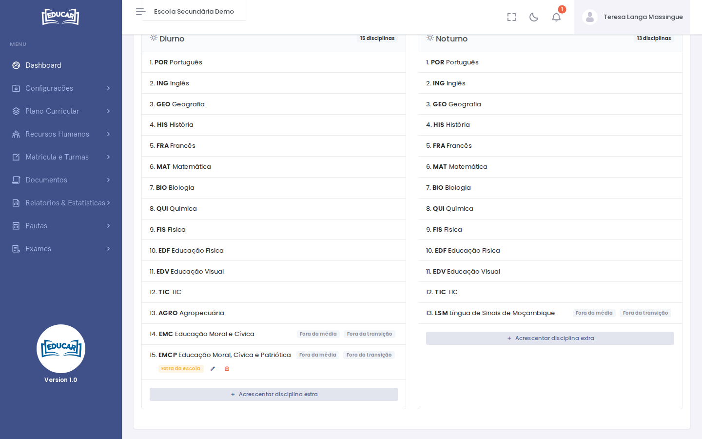
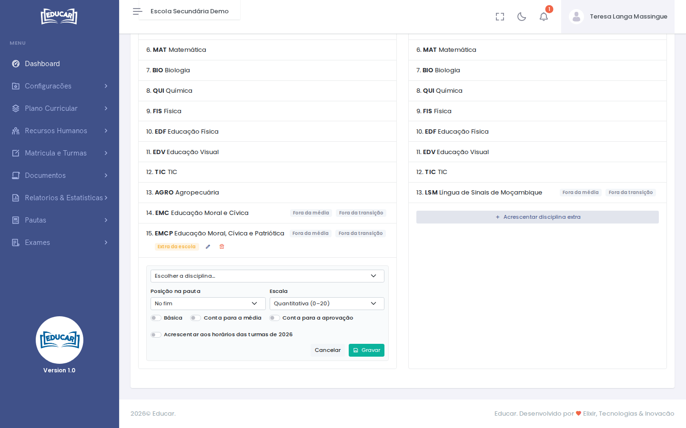

# Grade Curricular

**Menu:** Plano Curricular › Grade Curricular
**Quem vê:** Director da escola, Director pedagógico

O plano curricular de cada classe no ano lectivo e as disciplinas de cada classe, pela ordem em que aparecem nas pautas. Os planos vêm da ELIXIR: a escola escolhe entre os planos ligados a ela e pode acrescentar disciplinas extra.

Escolha primeiro o **ano lectivo**, no canto superior direito.

## Plano por classe

A tabela mostra o plano de cada classe nesse ano. A coluna **Origem** diz de onde ele vem:

| Origem | Significado |
|---|---|
| **Escolhido para o ano** | A escola escolheu este plano para o ano |
| **Do ano anterior** | Sem escolha para o ano, a classe continua com o plano do ano anterior |
| **Sem plano** | A classe ainda não tem plano |

Para mudar o plano:

- **de uma classe**, escolha o plano na linha e use **Gravar**;
- **de várias classes**, marque-as, escolha o plano em **Plano a aplicar…** e use **Aplicar às seleccionadas**.

Depois de haver matrículas, o plano da classe já não muda: a linha aparece com um cadeado e o número de matrículas. Se a lista não tiver o plano de que precisa, fale com a ELIXIR.

**Copiar as disciplinas extra ao mudar de plano** passa as disciplinas extra da escola nessa classe para o plano novo.

## Paralelismo pedagógico

**Paralelismo pedagógico** liga-se ou desliga-se para cada ano. Sem paralelismo, a nota final das disciplinas com exame é só a nota do exame. Cada ano novo parte do valor definido na ficha da instituição.

## Disciplinas e ordem na pauta

Em **Disciplinas e ordem na pauta**, escolha a classe para ver as disciplinas de cada turno, pela ordem das pautas. As etiquetas assinalam as particularidades de cada disciplina:

| Etiqueta | Significado |
|---|---|
| **Fora da média** | Não entra na média global |
| **Fora da transição** | Não entra nas regras de transição |
| **Qualitativa** | É avaliada de forma qualitativa |
| **Extra da escola** | Foi a escola que a acrescentou |

## Acrescentar uma disciplina extra

As disciplinas do plano não se alteram aqui, mas a escola pode acrescentar as suas, por classe e turno:

1. Use **Acrescentar disciplina extra**, no turno pretendido.
2. Escolha a disciplina.
3. Em **Posição na pauta**, indique onde fica.
4. Escolha a **Escala**.
5. Indique se é **Básica**, se **Conta para a média** e se **Conta para a aprovação**.
6. Para a incluir já nas turmas do ano, ligue **Acrescentar aos horários das turmas**.
7. Use **Gravar**.

Numa disciplina extra, o lápis corrige estes dados e o caixote do lixo retira-a.
