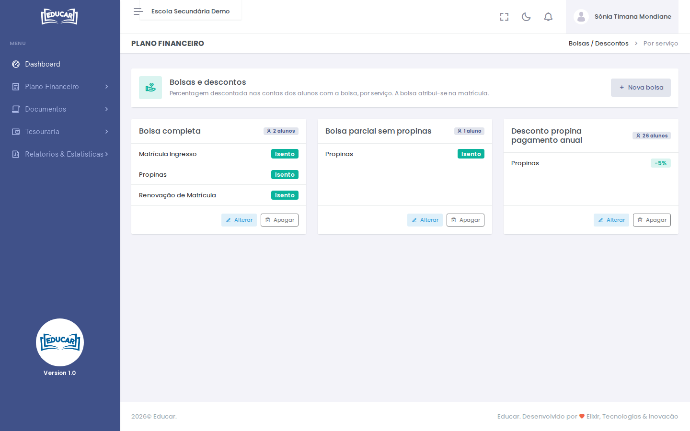

# Bolsas / Descontos

**Menu:** Plano Financeiro › Bolsas / Descontos
**Quem vê:** Director financeiro

As bolsas e os descontos da escola: a percentagem descontada, por serviço, nas contas dos alunos que os têm. A bolsa atribui-se na matrícula (ou na renovação).

Cada cartão mostra os serviços abrangidos e quantos alunos têm a bolsa. **Isento** quer dizer 100% de desconto.

## Criar ou alterar uma bolsa

1. Use **Nova bolsa** (ou **Alterar** no cartão).
2. Escreva o **Nome**, por exemplo "Bolsa completa" ou "Desconto de irmãos".
3. Indique o desconto só nos serviços abrangidos: uma percentagem, ou **Isenção total**. Deixe **Sem desconto** nos outros.
4. Use **Gravar bolsa**.

Uma bolsa com alunos não se apaga: primeiro retire-a das matrículas.
