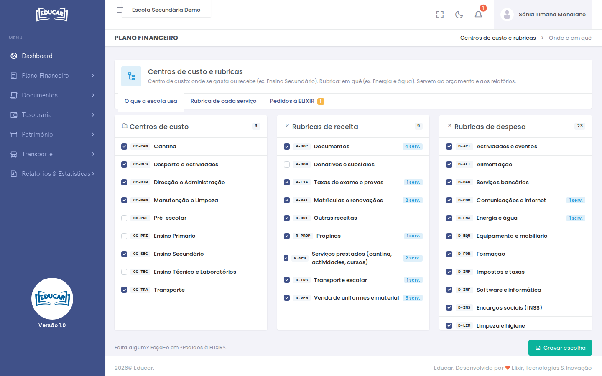
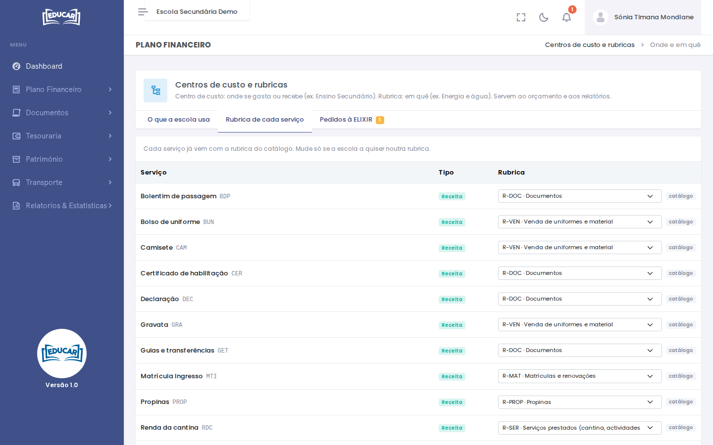
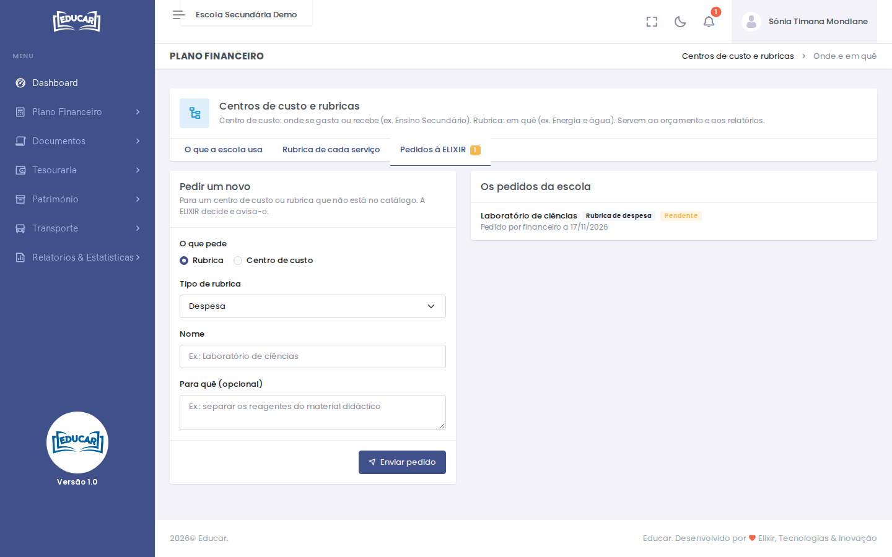

# Centros de custo e rubricas

**Menu:** Plano Financeiro › Centros de custo e rubricas
**Quem vê:** Director financeiro

Organizam o dinheiro da escola para o orçamento e para os relatórios:

- o **centro de custo** diz onde se gasta ou se recebe, por exemplo Ensino Secundário, Cantina ou Transporte;
- a **rubrica** diz em quê, por exemplo Propinas, Salários e remunerações ou Energia e água. Há rubricas de receita e de despesa.

A lista vem de um catálogo comum a todas as escolas, mantido pela ELIXIR. A escola escolhe os que usa e pede os que faltam.

## O que a escola usa

1. Marque os centros de custo, as rubricas de receita e as rubricas de despesa que a escola usa. Na primeira vez vêm todos marcados.
2. Use **Gravar escolha**.

Ao lado de cada rubrica aparece quantos serviços da escola caem nela. Uma rubrica com serviços não se desmarca: mude antes a rubrica desses serviços.

## Rubrica de cada serviço

Cada serviço de [Serviços e Preços](servicos-e-precos.md) já vem com a rubrica do catálogo (a etiqueta **catálogo**). Por exemplo, as propinas caem em Propinas, os uniformes em Venda de uniformes e material e a energia eléctrica em Energia e água.

Para pôr um serviço noutra rubrica, escolha-a na lista e use **Gravar rubricas**. Os tipos de despesa só aceitam rubricas de despesa e os outros serviços só rubricas de receita.

## Pedir um centro de custo ou uma rubrica

Quando falta um centro de custo ou uma rubrica no catálogo, peça-o em **Pedidos à ELIXIR**:

1. Escolha se pede uma **Rubrica** (de receita ou de despesa) ou um **Centro de custo**.
2. Escreva o **Nome** e, se quiser, **Para quê**.
3. Use **Enviar pedido**.

O pedido fica **Pendente** na lista ao lado. Se o nome já existe no catálogo, o ecrã avisa: basta marcá-lo na lista.

A ELIXIR aprova ou recusa o pedido, e o director financeiro recebe um aviso no sino:

- **aprovado:** o novo item entra no catálogo, com o seu código, e já vem marcado na escola;
- **recusado:** o aviso e a lista mostram o motivo, por exemplo a rubrica do catálogo que se deve usar.
