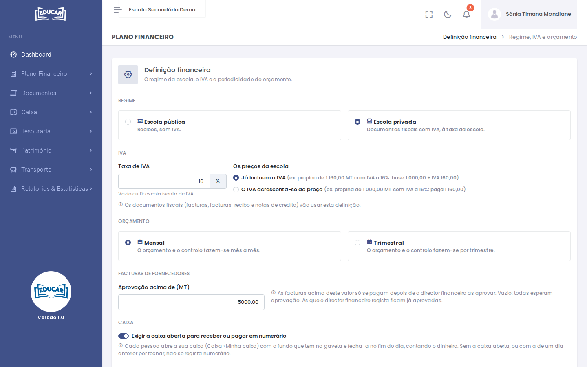
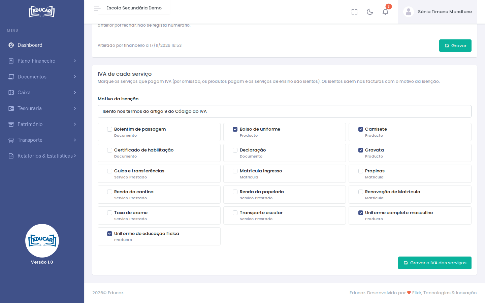

# Definição financeira

**Menu:** Plano Financeiro › Definição financeira
**Quem vê:** Director financeiro

O regime da escola, o IVA e a periodicidade do orçamento. Enquanto não for gravada, a escola conta como pública, com orçamento mensal.

## Regime

- **Escola pública:** emite recibos, sem IVA.
- **Escola privada:** emite documentos fiscais com IVA, à taxa da escola.

## IVA (escola privada)

1. Escreva a **Taxa de IVA**. Há escolas com uma taxa especial; vazio ou 0 quer dizer que a escola é isenta.
2. Escolha como estão os preços da escola:
    - **Já incluem o IVA:** o preço é o que o aluno paga. Por exemplo, uma propina de 1 160,00 MT com IVA a 16% tem a base de 1 000,00 e 160,00 de IVA.
    - **O IVA acrescenta-se ao preço:** o aluno paga o preço mais o IVA. Por exemplo, uma propina de 1 000,00 MT com IVA a 16% paga-se 1 160,00.

Com o IVA acrescido, o valor a pagar das contas e o preço das vendas já levam o IVA.

### IVA de cada serviço

Gravada a escola como privada, aparece o quadro **IVA de cada serviço**:

1. Escreva o **Motivo da isenção**, que sai nas facturas dos serviços isentos (por exemplo, `Isento nos termos do artigo 9 do Código do IVA`).
2. Marque os serviços que **pagam IVA**. Por omissão, os produtos (uniformes, material) pagam e os serviços (propinas, matrícula, exames) são isentos.
3. Use **Gravar o IVA dos serviços**. Vale nos recebimentos seguintes.

Cada recebimento de uma escola privada emite uma factura-recibo, e cada anulação uma nota de crédito: veja [Documentos fiscais](../tesouraria/documentos-fiscais.md).

## Orçamento

Escolha se o orçamento da escola se faz e se controla mês a mês (**Mensal**) ou por trimestre (**Trimestral**). Cada [orçamento](orcamento.md) fica com a periodicidade que estava escolhida quando foi criado.

## Facturas de fornecedores

Em **Aprovação acima de (MT)**, escreva a partir de que valor uma factura de fornecedor só se paga depois de o director financeiro a aprovar. Vazio, todas esperam aprovação; as que o director financeiro regista ficam já aprovadas. Ver [Contas a pagar](../tesouraria/contas-a-pagar.md#aprovacao).

## Caixa

Ligue **Exigir a caixa aberta para receber ou pagar em numerário** para que cada pessoa abra a sua caixa antes de registar numerário e a feche no fim do dia. Sem a caixa aberta, ou com a de um dia anterior por fechar, os recibos, vendas e despesas em numerário são recusados. Ver [Minha caixa](../caixa/minha-caixa.md).

Use **Gravar**. Por baixo fica quem fez a última alteração, e quando.
