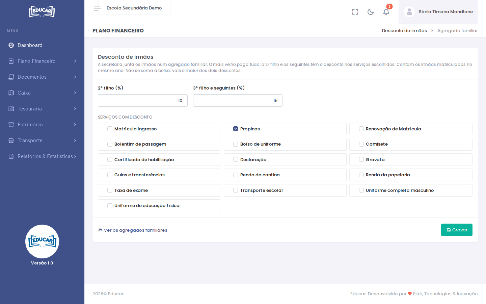

# Desconto de irmãos

**Menu:** Plano Financeiro › Desconto de irmãos
**Quem vê:** Director financeiro

O desconto para os irmãos que estudam na escola. A secretaria junta os irmãos num [agregado familiar](../matricula-e-turmas/agregados-familiares.md); aqui define-se quanto descontam e em que serviços.

1. Escreva a percentagem do **2º filho** e a do **3º filho e seguintes**. Vazio quer dizer sem desconto.
2. Em **Serviços com desconto**, marque os serviços em que vale (por exemplo, **Propinas**).
3. Use **Gravar**. O desconto vale logo nas contas por pagar.

## Como se conta

- Contam os irmãos do agregado com matrícula activa ou pendente no mesmo ano lectivo.
- O mais velho (pela data de nascimento) é o 1º filho e paga tudo; o seguinte é o 2º, e assim por diante.
- O desconto **não se soma à bolsa**: se o aluno tem uma [bolsa ou desconto](bolsas-descontos.md) no mesmo serviço, vale o maior dos dois.

Na ficha do aluno, em **Contas por pagar**, uma faixa mostra o agregado e o lugar do aluno, e o desconto de irmãos aparece com a etiqueta **irmãos**. O pagamento, o extracto, a app e o relatório de [Devedores](../relatorios-e-estatisticas/devedores.md) usam o mesmo desconto.
